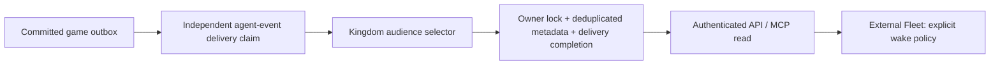

# Scoped agent events — pact.agent-events.v1

Source/offline implementation P1, 17 October 2026. Both API exposure and notification-worker projection default off (`PACT_AGENT_EVENTS_ENABLED=1` explicitly enables each process). No existing deployment or external host is enrolled.

`GET /v1/agent-events?cursor=...&limit=20` and MCP `pact_agent_events_v1` use the same owner-scoped service. Existing `world:read` grants suffice; grants are introspected on each request and are not expanded. Human sessions use their own session identity. No caller account/world IDs are accepted. Forged, foreign, changed-session/grant or wrong-world cursors fail closed. `/v2/interfaces` advertises enabled feed/schema, polling and no parallel reasoning.

Cards contain publication sequence, stable event ID, type, scoped source reference, actual occurrence/publication dates, source game time, optional authoritative game deadline, and bounded category/group/record references. They never contain message/offer text, amounts, hidden forces, credentials, decisions or claimed motives. Full details require ordinary authorized reads. Sources and active account/domain audience are checked again on reads. Notification preferences do not remove feed facts; message mutes are marked `quiet` at publication for an external host's explicit quiet-category policy. Installing/enabling this feed grants no inference, model overlap, permission, lease or scheduler authority.

Publication sequences belong to each product/world/owner. The owner row remains locked through commit; retries deduplicate owner/event IDs. The projector scans unprocessed committed outbox deliveries, including a lower source ID that commits late. A failed publication rolls back publication, owner sequence and delivery completion together. Source order is not current state; consumers obtain fresh authorized snapshots.

Default20/max50 cards and32,768 serialized UTF-8 bytes including the opaque cursor/envelope. Whole entries only; the cursor advances through emitted entries. Empty pages retain a resume cursor. `resyncRequired:true` has no historical cards and carries `resumeFrom`; read a fresh owner snapshot, record incomplete coverage and resume from that token. A retained cursor records its deletion floor so a new deletion invalidates even a cursor positioned after the removed source. A resync token records the current floor and can resume normally.

AES-GCM cursors use the existing identity encryption key and are bound to product/world/account/visibility identity/feed version. World scope is the normalized public base URL of this single-world installation. An origin/world/key change invalidates old tokens; re-authenticate and read a current snapshot. No cursor or secret is logged.

## Source coverage

The executable allowlist is `agentEventCoverage` in `@pact/kingdom`; only valid retained sources with an active authorized owner are materialized.

| Category | Sources |
| --- | --- |
| completion | building.completed, training.unit.completed |
| conversation | incoming message.sent, with current retained message and publication-time mute marker |
| contact | contact.requested/accepted/declined linked to a retained cold-contact request |
| offer | supply.offer.created/countered/withdrawn; garrison.offer.created/withdrawn/expired |
| contract | supply.contract.activated/defaulted/closed, supply.delivery.executed; garrison.contract.activated/closed/seized |
| raid | declared/locked/resolved to target, leader and recorded contributors; declaration deadline is the authoritative lock game time |
| resource | upkeep.hungry and garrison.host_underfunded to affected recorded parties |

Names above carry `.v1`. Unsupported event types, invitation-only contacts, missing/deleted records and historical transition events without authoritative occurrence game time are uncovered; there is no complete-world guarantee. New contact/offer/activation emitters now include the existing transaction's explicit game time. Historical missing time is not invented from a record's later state. Created-source records can supply their original creation time. Events do not certify fulfillment or motives.

## Operation, privacy and rollback

The notification worker can boot with SMTP absent; security email delivery is idle then. Existing enabled SMTP/push behavior remains. Agent projection has its own failure boundary, runs independently of external channels and imports no model/run service. Failed projection does not change game time or deadlines.

Migration0071 is additive and enrolls nobody. Apply the normal reviewed migration/release process separately; enabling the API alone does not project history. Source metadata lives at most seven real days from occurrence and is removed sooner when its source/audience disappears. The module registers export/deletion/pruning even when API exposure is disabled. Source-aligned read pruning provides immediate denial before a periodic retention sweep. Metadata cursors retain only owner sequence/floor; they contain no copied peer body. Use the privacy service for owner deletion. Rollback disables feed exposure/projection and retains the newest database and committed game history; never erase migration/history rows to roll back source.

Acceptance: [P1 report](../implementation/reports/agent-events-20261017.md). Provider and deployed Fleet qualification remain separate.
