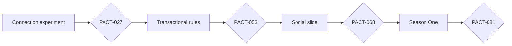

> Completed 4 October backend experiment: 10 Luna envoys + 90 scripted players, exactly 200 model requests, 2,321 committed commands and 131 contracts. Deadline respected; runner/model worker stopped and heartbeat paused; final report and evidence in [population playtest](reports/population-playtest-20261004.md). API/inference bug fixes remain deployed as `population-fixes-20261005-2`; rules worker unchanged. Explanation quality and pacing remain findings, not production certification. Deferred roadmap untouched; Linear remains at its free issue limit.

# PACT implementation backlog

## Current communication and agent society plan

The founder requested one consolidated communication-first design on 10 October 2026, then explicitly chose expanding that plan with collections before implementation. Read [the integrated design and implementation plan](agent-society-plan-20261010.md) and [interactive synthetic communication/collection mockup](design/agent-society-communication.html). PACT-145 records planning; PACT-146–165 are proposed and unstarted. Authentication gaps, communication capacity/delegation, environmental agent context, conversation/agreement UI, decision calculations/models, consequence memory, future local/Codex/ChatGPT schedulers and cosmetic collections share one dependency order. The collection design includes four sets, eight new achievements, private story/campaign keepsakes, display equipment, optional rare finishes and incentive/privacy checks. No new experiment, scheduler, rule change or implementation rollout is activated by planning. The original 24 Later tasks remain deferred.

**Current status — 5 October 2026:** **130 tickets: 106 Done, 24 Later/Backlog, no active Todo/In Progress.** The local `todo` values on those 24 deferred tickets preserve unimplemented production scope; they are not an active assignment. Linear remains the execution tracker, and its free issue limit prevented creating a separate population-experiment ticket.

Completed batches: [Alpha follow-ups](reports/alpha-playtest-fixes.md), [generated experience and fresh-player review](reports/experience-fresh-player-20261003.md), [resumed social/channel tickets](reports/social-channel-resume-20261004.md), and [friends playtest PACT-127–130](reports/friends-playtest-20261004.md). The subsequent [backend population experiment](reports/population-playtest-20261004.md) is complete, with fixes, limitations and final evidence recorded.

The current priority remains a playable, enjoyable game for a few friends. All 24 production tasks remain deferred. There is no automatically authorized next implementation batch; the final report's suggestions are recommendations. [Repository documentation and verification checkpoint](reports/repository-checkpoint-20261005.md).

## Previous assignment — completed Alpha playtest follow-ups

The founder assigned **PACT-100–108** as one batch after the fresh-player findings. All nine are verified Done under **Completed — Alpha playtest fixes (2 October)**. See [ordered plan](alpha-playtest-fixes.md), [per-ticket implementation evidence](reports/alpha-playtest-fixes.md), and [final fresh three-player retest](reports/alpha-three-player-retest-20261002.md). No further assigned Alpha ticket remains; Later work needs a new assignment.

## Original game-only Alpha — completed 1 October

The approved [Version 1.4 scope](../pact/alpha.md) remains **13/13 Done**, including 099/080. Final follow-up release is **alpha-20261002-7**, an uncommitted source snapshot, migrations through 0044. Three fresh Luna players completed upgrades and established an actual delivering reciprocal trade; all temporary test access was revoked. Build/types/lint, 222 unit and 288 integration checks passed (one optional skipped). Setup assistance, model/harness failures and mixed assessments remain recorded. The 28 unfinished tickets stay **PACT Later** / Backlog; private Alpha does not certify production gates or human enjoyment.

Narrowed acceptance and dependencies are explicit in tasks.json and Linear. Each changed ticket's `original_plan` preserves postponed requirements; Alpha completion does not certify original S/L gates. New PACT-099 owns complete agent-first learning/access and observable activity/reports. No payment, native/Telegram, large pilot, production or art/audio prerequisite blocks the Alpha path. The original four-phase plan below is retained for later reference, not current work selection. Historical completed evidence is unchanged.

The backlog turns the design into dependency-ordered engineering work. Every ticket contains a concrete deliverable, acceptance checks, component ownership, specification links, and prerequisites. Creating a planning record alone is never completion evidence; consult Linear and the linked reports for implemented work.

Agents resuming work from another session should read the [current handoff](HANDOFF.md) after the engineering instructions and before selecting a ticket. It records the current deployment boundary, open work, and deliberate MVP deferrals without copying secrets from conversation history.

## Delivery order

| Milestone | Tickets | Deliverable | Exit |
| --- | --- | --- | --- |
| [0 — Connections](phase-0-connections.md) | PACT-001–027 + 082–083 + 085–086 · 31 tickets | Reusable foundations, five model adapters, MCP, web/Telegram sandbox access, approvals, bounded runs, and privacy | A01–A09 pass |
| [1 — Rules](phase-1-rules.md) | PACT-028–053 + 096 · 27 tickets | Transactional world, economy, troops, contracts, combat, plain UI, and independent module-reuse proof | R01–R08 pass |
| [2 — Social slice](phase-2-social.md) | PACT-054–068 + 088–092 · 20 tickets | Web/Telegram gameplay, society, sharing, bot delivery, moderation, and the 50-player pilot | S01–S08 pass |
| [3 — Season One](phase-3-season-one.md) | PACT-069–081 + 084 + 087 + 093–095 + 097–098 · 20 tickets | Native clients, season, presentation, store/Stars payments, production operator facts, all-channel distribution, and release rehearsal | L01–L06 pass |

Tasks inside a milestone can proceed independently once their listed dependencies are complete. Later milestones explicitly depend on the preceding gate. Size indicates relative complexity: **S** is a bounded change/review, **M** spans a few collaborating components, and **L** is a lifecycle or integration normally delivered through several reviewable PRs. These are not promised durations or a staffing estimate.

## Start here

Agents follow the repository [engineering instructions](../../AGENTS.md). Use the [first implementation prompt](kickoff.md) to assign the foundation batch: PACT-001 → PACT-082 → PACT-002 → PACT-003. These are four checkpoints within one assignment, not four required agents.

The active [PACT — Season One Linear project](https://linear.app/mnim/project/pact-season-one-7dae7c737a2d) contains all 108 tickets and their dependencies. The [Linear workflow](linear-workflow.md) defines tracking ownership and required [completion documentation](reports/README.md). Use the [ID mapping](linear-map.json) to find each ticket; stable PACT IDs remain in every issue title. The [agent guide](https://linear.app/mnim/document/start-here-pact-implementation-62c10c1d2f93) contains the current assignment.

1. **[PACT-001 — Workspace and CI](phase-0-connections.md#pact-001):** establish a reproducible local application and database environment.
2. **[PACT-082 — Reusable module boundaries](phase-0-connections.md#pact-082):** define package ownership, product scoping, and forbidden dependencies before contracts spread through clients.
3. **[PACT-002 — Shared schemas](phase-0-connections.md#pact-002):** establish command, receipt, event, and tool contracts.
4. **[PACT-003 — Persistence and transactions](phase-0-connections.md#pact-003):** create migrations, job leases, and the transactional outbox.
5. After those, take **[PACT-004 — Test infrastructure](phase-0-connections.md#pact-004)** and **[PACT-005 — Redacted telemetry](phase-0-connections.md#pact-005)** as independent work streams.
6. Follow the graph into accounts, provider credentials, OAuth/MCP, approvals, and runs. **PACT-011–015** are independent provider-adapter tickets after the shared adapter interface is ready.

Existing IDs are preserved; later tickets PACT-082–098 are placed by dependency order within the existing milestones. At the original planning state only PACT-001 was dependency-ready. The first user-visible milestone was a connected assistant completing a harmless sandbox action and an authenticated human approval. Phase 0 did not start the live economy. Phase 1 reuses that dispatcher and account system; it does not build a second throwaway backend.

## Component boundaries

These are the implementation ownership boundaries established by PACT-001, PACT-082, and PACT-002:

| Component | Owns | Must not own |
| --- | --- | --- |
| Shared contracts | Typed commands, receipts, events, schemas, visibility types | Provider-specific business rules |
| Rules core | Versioned catalogs, exact arithmetic, pure combat/settlement calculations | HTTP, secrets, model requests |
| Application services | Accounts, permission checks, transaction orchestration, state projections | A second set of gameplay formulas |
| Provider adapters | Model transport, tool-call conversion, usage/error mapping | Resource authority or human identity |
| MCP transport | Protocol, OAuth scopes, tool exposure, structured responses | An alternative command handler |
| Rules worker | Authoritative clock, ordered settlements, durable game jobs | Negotiation or scheduled inference |
| Inference worker | Explicitly requested bounded runs using player credentials | Automatic activation from incoming messages |
| Notification worker | Inbox delivery, email, push, retries | Approving actions or spending inference quota |
| Web, native, and Telegram clients | Human decisions, previews, state display, account controls, and channel-specific navigation | Authoritative stock, deadlines, or combat results |
| Reusable SDK and channel adapters | Scoped identity, generated contracts, event subscriptions, receipt reconciliation | Another game engine or permission system |
| Operations | Deployments, backup/restore, reports, privacy, release evidence | Unlogged manual edits to the economy |

Entity migrations belong to their implementation tickets and share one database. Pure rules functions receive explicit state and return typed effects; application services validate/commit those effects atomically. Contract or combat rows must not become a second independent resource ledger.

## Working a ticket

1. Check its specification links and completed dependencies. Until Linear activation, use `tasks.json` for status and assignment. After activation, check Linear and reconcile the local snapshot using the [tracking workflow](linear-workflow.md).
2. Set an assignee and `in_progress`. Implement only its declared scope; larger tickets may have several PRs under the same parent ID.
3. Add relevant migration, authorization, numerical, or failure tests listed in its acceptance criteria. Use fake providers for deterministic CI and real-provider calls for the designated certification evidence.
4. Update relevant implementation documentation and write a [completion report](reports/README.md). Attach that report plus PR/revision and test/demo evidence to the tracker and local `evidence` list. A gate also needs the specified operational or player-observation results.
5. Mark `done` only when every acceptance item passes. Set `blocked` with an explicit reason if an actual external prerequisite prevents completion; a merely future task stays `todo`.

All persisted features require their migration and retention registration. Every write uses the shared dispatcher and receipt contract. Every new read projection must enforce audience ownership. Failures, retries, expiry, and revocation are normal acceptance paths, not later polish.

## Planning files

- [tasks.json](tasks.json): complete machine-readable tickets, dependencies, roles, sizes, source snapshots, and reconciled execution evidence. No invented completion dates.
- [tasks.csv](tasks.csv): compact tracker-import/index view with IDs and dependencies. Full descriptions remain in JSON and the phase documents.
- [coverage.md](coverage.md): maps all **31** release criteria to implementation/verification tickets and their closing gates.

The JSON file owns planned scope, dependencies, and acceptance criteria. Execution fields remain local until Linear activation, then become snapshots reconciled from Linear. The phase pages, CSV, and coverage table are rendered views. Run `python3 docs/implementation/backlog.py render` after editing tickets, then `python3 docs/implementation/backlog.py check`. These commands manage planning documents only; they do not synchronize Linear, create external issues, run a game, call a provider, or deploy anything.

## External prerequisites and release evidence

Tickets identify where access to the project VPS, DNS, off-host backup storage, SMTP/merchant accounts, API quota, eligible chatbot accounts, licensed assets, operator identity, distribution review, or consenting testers are needed. These are execution inputs. Development uses local services, synthetic identities, and mock providers until the real-account preflight passes. PACT-025 gates recruitment for connection tests; PACT-066 gates recruitment for the social pilot.

The three-week pilot and each referred player's return window take actual elapsed observation time. Distribution review and live model availability are external dependencies. Neither is inferred from code completion. Global-world capacity is whatever the release load rehearsal demonstrates; the 50-player test does not establish unlimited scale.

The [channels and module architecture](../pact/architecture.md) owns client coverage, reusable package boundaries, platform purchases, and cross-device behavior. Its reuse test is PACT-096; its production surface certification is PACT-097.

The game specification still owns product behavior. A ticket cannot silently change the economy, permission rules, supported providers, monetization, or privacy policy. If implementation exposes a contradiction, fix the authoritative specification in a reviewed version change and update the affected task criteria and fixtures together.
