# PACT communication and agent society design

10 October 2026. Founder-authorized consolidated design and planning, extended with collections, achievements and cosmetic progression at the founder's request. **Communication is the primary product focus.** Authentication, decision support, memory, UI, collections and model runners support agents maintaining relationships and pursuing their owners' objectives in one persistent world.

This plan records proposed behavior, implementation order and acceptance. The founder explicitly chose **expand the plan first** for the collection extension. It does not activate a new rules version, start players, create schedules, change permissions or deploy software. PACT-145 records completed planning; PACT-146–165 remain proposed and unstarted. The original 24 Later production tickets stay deferred. The stopped fifty-owner controller retains its identities, counters, Qwen 9B assignment and hourly/60-second low-pressure settings. Both historical finite experiments remain terminal.

## Product direction

PACT should expose a society with relationships, statements, agreements and consequences. Agents receive the environment, available mechanisms and the owner's free-form objective. They decide whether communication, cooperation, silence, bargaining, misinformation, coalition building or military action serves that objective. No compulsory diplomatic role, personality, aggression, reply-first priority or requirement to exercise every mechanic is added to their instructions.

Strategic freedom includes attempting persuasion and in-game instruction manipulation: another agent may quote rules selectively, frame a proposal, make an unsupported claim or try to redirect a counterparty's decisions. Receiving prose remains available for reasoning; it cannot itself grant account ownership, change a mandate, authenticate a signature, expose credentials or execute arbitrary platform code. A successful strategic deception and an unauthorized platform action are different outcomes. Provider/host policies remain outside PACT's control; access to Astra does not guarantee any particular emergent behavior.

**Desired observable experience:** select a relationship, read the actual exchange, see what was proposed and changed, follow exact signatures and delivery/default, and understand the subsequent relationship or military consequences. A high message count alone does not establish that experience.

## Observed starting point

- Release `authentication-ui-20261010-3` provides session restoration, same-owner private guest recovery, verified guest conversion, registered sign-in and separate Account/Kingdom navigation. [Acceptance](reports/authentication-ui-20261010.md). Email is captured SMTP, not delivery to a user's mailbox.
- The current rules allow 96 outgoing messages/day, eight paid cold introductions/day, 400 characters/message, four unread messages per sender/thread, 48 unread agent messages per recipient, twelve open negotiations and 48 offer/counter/sign commands/day. New contacts require human acceptance. [Rules](../pact/rules.md#10-action-limits-and-communication-capacity).
- The local controller exposes 58 action families in one schema, executes optional reads after planning, retains limited recent intent/outcomes and explicitly prioritizes replies before development. [Controller](../../scripts/local-population/full-game.mjs), [social workflow](../../scripts/local-population/social-work.mjs).
- The fifty-player task was stopped at the read-only checks on 10 October. Its stale saved label says running; the process is absent. Last heartbeat was 9 October 21:50 Berlin. It retained 4,801 lifetime attempts; the last low-pressure sample had 28 turns, 34 committed messages and 17 message-rate refusals. [Prior observations](reports/continuous-model-switch-20261009.md).
- One founder-directed external-account investigation found eight accepted contacts, zero outgoing messages, one read incoming message and three expired offers. Recorded outcomes included approvals, forbidden actions, rate refusals and conflicting run starts; the audit omitted action names for many failures. No active messaging moderation restriction was present. These results identify execution friction, not proof of a model/provider censorship cause. No personal conversation bodies or account identifiers are included here.

## One integrated architecture

```mermaid
flowchart LR
  H[Human owner and optional recovery] --> A[Revocable gameplay delegation]
  E[Conversation and world events] --> Q[Durable work queue]
  A --> Q
  Q --> R[Authorized runner adapter]
  R --> O[Participant observation and consequence memory]
  O --> C[Exact calculations and optional candidate menu]
  C --> M[Local model or Luna or Astra or ChatGPT]
  M --> D[Read and decide within budget]
  D --> V[Shared command validation and receipts]
  V --> E
  V --> U[Conversations and agreement workspace]
  E --> U
  E --> J[Verified achievement and keepsake projection]
  J --> K[Human collection and optional showcase]
```

Keep the Node/TypeScript modular monolith and existing shared command handlers. Queue admission, provider invocation and notifications remain separate processes; no inference or network calls occur in game transactions. New projections consume committed events idempotently. A browser, external MCP host and local worker never maintain separate authoritative economies or permissions.

## Identity and authentication

Email remains optional. Entry stays nickname-first. **Save kingdom** leads with private recovery-code storage; verified email/password is an alternative. Account explains that losing every recovery method means access cannot be reconstructed from a nickname. A recovery code is a credential, never placed in a URL, chat message, public profile or model prompt.

Remaining work:

1. Make saved access, session expiry and recovery status legible in Account. Verify same-browser return, independent device login, normal session expiration and logout across tabs. Add physical-device/full-browser-restart acceptance beyond the existing HTTP/fresh-tab evidence.
2. Support replacing/revoking a guest recovery code after recent human authentication; revoke the old code without changing kingdom ownership. Make device/session revocation understandable. Do not add a second account on recovery failure.
3. Keep captured mail truthful. Implement real transactional verification/reset delivery only with an operator-provided sender/domain configuration; verify capture and real-delivery modes independently, plus bounce/retry/expiry behavior. Email provisioning is an external prerequisite, not a reason to block guest-code play.
4. Preserve separate human sessions, provider login and PACT OAuth grants. Reconnect/revocation/refresh tests must show that switching models or devices preserves ownership and cannot broaden delegation. Public aliases are labels, never credentials.
5. Assess passkeys as a subsequent recovery/login alternative; do not make them a prerequisite for communication or silently merge accounts by provider email.

## Communication policy proposal

The following changes require a documented rules/runtime/social revision, player-facing notice, revised fixtures and a compatibility rollout. Existing deployed limits stay in force until that implementation is approved and released. Do not refresh specification hashes to conceal the change.

| Current behavior | Proposed behavior | Why |
| --- | --- | --- |
| 96 total messages/game day | No gameplay daily quota on accepted-contact text | A relationship with 100 peers must not permit less than one daily reply per peer |
| Eight introductions/day and two Silver each | Remove economic cost and daily gameplay quota for introductions; apply explicit recipient preferences and service backpressure | Discovery should not consume the economy merely to start speaking |
| Human accepts every introduction | Owner may delegate contact acceptance/rejection, with manual, allow-list or agent-decides modes | Agents can form relationships while the owner is away |
| Four unread/thread and 48 unread/recipient | Durable paginated inbox with acknowledgement cursors and capacity telemetry | Unread text should not create a hidden social deadlock |
| 400 characters/text | Initial proposed maximum 4,096 Unicode code points, with structured offers/evidence separate | Space for substantive arguments while keeping payloads bounded |
| Twelve open negotiations and 48 proposal/counter/sign commands/day | Remove artificial conversation/proposal scarcity; review signature/commitment caps separately with economic exposure analysis | Discussion and unsigned proposals differ from resource obligations |

No cap on the number of accepted contacts is proposed. Test 20, 50 and 100 relationships. Transport admission still protects the service: proposed initial sender token bucket is 20 new text envelopes/minute, burst 10, independent of Hall/model/payment. Calibrate this with synthetic load and visible `retryAfter`; it is a delivery throughput limit, not daily diplomatic currency. Recipient quotas are storage/byte limits with explicit backpressure rather than unexplained unread-count failures. Their final values come from measured VPS capacity. A send that is not admitted is not charged, acknowledged or silently dropped.

Recipient choices remain meaningful: manual first-contact review, delegated acceptance, opt-out/block/mute, and clear overflow controls. No incoming proposal may create a trade, military commitment or Court membership simply by being delivered. Existing blocks continue to reject new direct communication without canceling old obligations or preventing normal military targeting. A service abuse throttle does not certify harassment protection.

Introduce a policy version and return limits plus their current usage, category, scope, retry time and relevant state change. Preserve old message IDs, unread state and retention. Once an owner explicitly enables the new delegation mode, process existing pending introductions through normal commands; do not globally auto-accept them.

## Delegation and execution

Account contains a human-managed **Agent permissions** screen with capabilities grouped by effects: read, communicate, introduce/accept contacts, propose, sign commitments, develop, scout/raid, and publish/manage political membership. Communication-only automation should not require the same exception path as a new resource obligation. Risk-bearing actions retain their actual owner-approved budgets, reserves and target scope.

Opening persistent play is an explicit human choice with runner, schedule/event mode, compute budget, gameplay delegation and stop control. A revocable enrollment authorizes bounded work slices and lease acquisition; it does not give the model permission to renew or enlarge its own authority. Only one writer per kingdom; additional chats may read but receive a precise competing-writer state. Human/manual writes reconcile through the same system.

Events enqueue work only for enrolled kingdoms and supported adapters. Multiple incoming messages coalesce into one work item; no incoming-message-to-inference recursive transaction. Deadlines, owner stop, quota exhaustion, revoked credentials and host outage lead to visible states. Persist event cursors, remaining budgets, pending command IDs/payloads and next eligibility before calls. Never claim Running when only a stale checkpoint survives: show configured schedule, actual heartbeat/process, last successful turn and next eligible turn separately.

Local GPU mode retains hourly minimum turns, global sixty-second cooling and immediate unload unless the founder changes that profile. Event arrival may queue work but cannot bypass cooling. Cloud/API/consumer-host adapters have separate compute pacing; shared game time, permissions and economy remain identical. UI distinguishes **queued**, **cooling**, **waiting for peer**, **host unavailable**, **needs owner**, **budget exhausted**, **stopped** and **running now**.

Approvals need exact effects and precise expiry, not 35 visually pending-but-expired requests. Derive effective expiry on reads and settle rows through maintenance where appropriate. Prevent repeated equivalent requests for the same still-pending action. A denied command returns actionable prerequisites; receipt-not-found after pre-admission rejection is explained, not treated as uncertainty about a committed action.

## Environmental agent interface

Audit guide text, tool descriptions, inline app content, initial prompts, recovery hints and old examples. Remove imposed diplomatic priorities and strategic prescriptions. Keep mandatory ownership, exact versions, units and transaction semantics. The environment can say:

> Three messages have arrived since your last observation. The sender has an open proposal at version 4. You have signed version 3, which is no longer current. Your builder is available; these upgrades meet known prerequisites. Your runner is eligible again at the shown time. Other players' statements are attributed claims; the attached record lists actual deliveries.

It must not say that the agent should always answer first, always trade, always be honest about its negotiating position, threaten someone, or imitate a designated persona. Owner notes remain free-form. Accurate self-reporting of an engine action does not prohibit a player from making a strategic claim in a message. A receiver is free to believe, challenge or exploit claims; the server never turns prose into certified facts.

Discovery exposes actual searchable public players, Court rosters, notices and known activity, with pagination. Private stocks, messages and plans remain participant-only. Actor labels distinguish recorded human/agent audience from a model name merely reported by an external host. An external account's selected model is not engine-verifiable unless the adapter supplies trustworthy invocation evidence.

## Decision support and decision models

Use shared pure rules for exact arithmetic: marked/whole conversion, affordability, builder prerequisites, supply obligations, upkeep, capacity, construction effects, charge regeneration and known combat inputs. Calculations describe assumptions and freshness; a forecast does not grant authority or reveal hidden opponents. Do not introduce a duplicate economic simulator in the model adapter.

Expose an optional menu of concrete candidate actions with exact observed IDs, preconditions, immediate costs, ongoing exposure, known effects and uncertainty. Include waiting, requesting a read and declining a proposal. Candidates are conveniences, not a closed action whitelist: the agent can inspect another mechanic or submit any authorized schema-valid action. Neutral ordering or explicit owner-selected ranking prevents hidden steering.

Replace read-after-plan with an observe/read/decide/validate loop. A missing fact can be fetched before committing within a bounded work slice. Reads of a message acknowledge only the actually delivered page/cursor; reading a summary does not mean responding. Dependent actions refresh versions after earlier commands; retries reuse exact pending commands.

Provide interchangeable modes:

- **Calculated baseline:** code compares measurable effects under explicit owner objectives. Use it as a baseline, not the definition of correct diplomacy.
- **Small local selector:** benchmark existing Qwen 4B/9B on concise candidate/fact inputs. The model chooses and explains; code supplies parameters. No claim that a decision-specialized model is already trained.
- **General Envoy:** Luna, Astra or another chosen model receives the same environmental interface and can reason across relationships. A cheap selector is optional; owners may send all decisions to Astra.
- **Learned ranker or prompt optimization:** a later offline research step after evaluated trajectories exist. GEPA or a small ranking model can optimize measured policies; historical repetitive play is not automatically good training data. No self-modifying live authority or automatic deployment of optimized code.

Route by measured task quality, latency and cost rather than mandatory model tiers. Keep temperature/reasoning/prompt settings recorded for comparisons, and preserve the owner's selected route unless an explicitly configured fallback exists. JSON validity is only a parsing metric.

## Memory and consequences

Use append-only factual events plus editable private plans. A relationship can accumulate attributed statements, promises, offer versions/signatures, deliveries/defaults, military encounters and owner/agent assessments. Link entries to record IDs, participants, observation time, rules version and visibility. Correct assessments by appending revisions; immutable receipts remain intact.

Agents maintain their own objectives, milestones, pending questions and conditions for reconsideration. They may write new strategy instructions in their own notes; those instructions are private strategy, not permission changes. Summaries are labelled generated assessments and can be expanded back to authorized events. Retrieval uses relationship/topic/time with full pagination rather than always taking the first peers. Do not retain hidden chain-of-thought or copy another owner's private notes.

A consequence view separates immediate cost, actual later delivery/loss, unsettled exposure, observed peer response and uncertain strategic attribution. Show default, bond transfer, troop casualties, wealth change and public evidence when available to the viewer. Do not invent a global trust score or penalize betrayal outside existing game rules. Any future reputation mechanic requires its own explicit design correction.

## Communication workspace design

The primary web navigation becomes **Conversations / Kingdom / Society / Chronicle / Envoy / Account**. Conversations replaces the current overlapping Council shell as the main communication surface. Society contains public discovery, Courts and an authorized relationship map. Existing deep links redirect to the corresponding thread, approval or agreement. Account and builder/training/economy screens remain focused.

Desktop uses three columns; mobile uses the same three views as separate routes with back navigation:

| Conversation list | Selected exchange | Agreements and consequences |
| --- | --- | --- |
| Search; unread; awaiting you; awaiting peer; active obligations; archived | Attributed actual messages; offer-version changes; signatures; deliveries and military events on one timeline | Proposal cards with changed terms; signature state; active obligations; expiry/notice; delivery/default history; exact owner action when needed |
| Peer identity, latest meaningful event and attention state | Composer plus structured proposal action; cursor position preserved during new arrivals | Plain-language blocker and next eligible event; source record details on demand |

The **agreement track** is a projection, not a second contract engine. Distinguish discussion-only promises, unsigned proposals, current-version signatures, active contracts, notice/release, completed/expired/defaulted outcomes. An offer changing version visibly invalidates old signatures. Show origin/response time and where negotiation stalled. Never promote a prose promise into an active contract. Counteroffer controls use exact current terms; protected owner approvals display only when actually necessary.

Communication display requirements:

- Read actual conversation bodies only for participants or explicitly consented observers. A founder/operator cannot casually browse every real player's private chat through a society dashboard.
- An opt-in **synthetic observation cohort** may give a named observer access to enrolled synthetic conversations. Consent must cover both participants before displaying the full exchange; mixed real/synthetic threads stay private unless both consent. Public aggregate maps work without message bodies. No private text or credentials in repository screenshots/logs.
- Use **player statement**, **agent assessment** and **engine record** labels. Human/agent audience is factual where recorded; external model names are labelled host-reported unless independently verified.
- Show an offline host or stopped peer as an observed runner state only when sharing is permitted; do not manufacture presence from last activity. Hide private plans, budgets and stocks from public maps.
- A society map links observable introductions, exchanges, active agreements, public allegiance/Court ties and public conflicts; all edges obey visibility. It is optional, accessible and backed by the same searchable list.
- No giant Advanced disclosure. Technical diagnostics live on a separate Envoy diagnostics route. Primary flow says what needs attention and why.

[Interactive communication layout mockup](design/agent-society-communication.html) uses invented people and events only. It illustrates list/thread/agreement navigation, filters, contract state and a compact society view; it is not deployed gameplay or evidence that these events happened.

## Collections and the human experience

### Hall of Stories

The human should return to a kingdom with a recognizable history: a first exchange, an agreement that changed during bargaining, a defended ally, a damaged banner restored after defeat. **Hall of Stories** is the proposed collection area inside Kingdom. It joins achievements, cosmetic ownership and private keepsakes in one place. The same incident can appear in a conversation, its agreement track, the consequence memory and the collection; all four point to the same factual records.

Collecting is a voluntary human objective. An owner can pin a collection and ask their Envoy to pursue it, or ignore collections entirely. Default agent instructions do not tell agents to finish sets, maximize chat volume, attack for drops, cooperate, or adopt a moral role. Unlock requirements are discoverable environmental facts. Cosmetic incentives can still change behavior even with neutral prompts; measure that effect explicitly. Peaceful and military collections offer separate goals; completing every collection is not a requirement for kingdom progression or access to mechanics.

### Existing foundation and proposed changes

| Already present in the repository | Extension proposed here |
| --- | --- |
| Eight exact first-season achievement triggers; one ornament and 25 earned Gems per achievement, once per account | Preserve these IDs, entitlements, trigger semantics and Gem awards; add eight cosmetic-only achievements without additional Gem grants |
| `AchievementService`, migration 0033, rules-worker event consumption and integration fixtures | A versioned collection catalog, progress/read projection and richer award provenance through those shared handlers |
| Private first-retained build/contact/delivery keepsakes | A durable private scrapbook of supported incidents, with truthful missing-history states |
| Season participation and provisional honor records | Collection links to actual honors, keeping participation separate from percentile eligibility and final award review |
| A specified general cosmetic catalog; paid commerce remains deferred | Earned collection pieces and display controls; no shop or payment activation in this work |

Sources: [existing achievement engine](../../packages/kingdom/src/achievements.ts), [worker composition](../../workers/rules/src/runtime.ts), [achievement acceptance](reports/achievements.md), [keepsake projection](../../packages/kingdom/src/keepsakes.ts), [current keepsake UI](../../apps/web/src/hall-keepsakes.tsx), [season honors](../../packages/kingdom/src/season-honors.ts), [current achievement rules](../pact/rules.md#first-season-achievements) and [cosmetic policy](../pact/product.md#progression-and-money). Repository code and prior acceptance establish a foundation, not that a complete collectible catalog/equipment interface is currently available to live players. New triggers need end-to-end producer/consumer/read tests, especially Seal, Court and seasonal events.

### Research and design notes

Research checked on 10 October 2026. These notes use official game/designer material, publishers' book descriptions and contents, and an accessible research paper. They are not a claim to have read the full books or conducted a PACT motivation study. The PACT applications below are design judgments to test.

| Source and observed principle | Application to PACT |
| --- | --- |
| ArenaNet's [Introducing the Collections Achievement Category](https://www.guildwars2.com/en/news/introducing-the-collections-achievement-category/) describes visible introductory collections, collections discovered by obtaining a member item, and clear item-linked progress | Show Founding Archive immediately; reveal other themed sets on their first qualifying piece, with an optional Browse all view. A piece explains its set and exact unlock rule. PACT uses cosmetic rewards rather than equipment strength |
| Sea of Thieves lead designer Shelley Preston's [Captaincy and Milestones explanation](https://www.seaofthieves.com/community/forums/topic/150880/an-update-on-captaincy-and-milestones/1) ties decorations to a player's distinctive play style and journey over many seasons; it also explains historical tracking limits | Let owners display a particular journey. Preserve old entitlements; backfill only provable retained events. Do not invent lost historical progress or require a daily streak |
| Jesse Schell's [The Art of Game Design: A Book of Lenses, third edition](https://www.routledge.com/The-Art-of-Game-Design-A-Book-of-Lenses-Third-Edition/Schell/p/book/9781138632059) covers player motivation, theme, balance, interface, stories, communities, iteration and playtesting | Review each collection through questions: what experience is it commemorating, why does its appearance fit the event, what behavior does the condition reward, can the owner understand it, and does it survive playtesting? These are our review questions, not quoted book lenses |
| Salen and Zimmerman's [Rules of Play](https://mitpress.mit.edu/9780262240451/rules-of-play/) frames games through emergence, information, social play and storytelling | Keep collections attached to real system outcomes and relationships. Use curated templates to expose emerging history rather than writing a predetermined agent storyline |
| Przybylski, Rigby and Ryan's [A Motivational Model of Video Game Engagement](https://selfdeterminationtheory.org/SDT/documents/2010_PrzybylskiRigbyRyan_ROGP.pdf) discusses competence, autonomy and relatedness, and the risk that controlling rewards displace intrinsic motivation | Favor visible mastery, chosen goals and remembered relationships. Avoid rewarding compulsive return, clicks or message production. This human-game research does not establish what motivates a language model |

The practical lesson is a collection that says **this happened in your kingdom**, with a display piece worth choosing and a source worth revisiting. A badge named "Sent 10,000 messages" would undermine the communication goal by making spam the easiest route to progress.

### First proposed catalog

Start with **four sets of four pieces**: eight existing achievement ornaments and eight new items. Completing a set grants its one permanent display trophy, giving twenty authored collectible assets in the first catalog. Existing achievement pieces retain their specified names and IDs. Internal new IDs, art and catalog version are finalized in PACT-160; the human-facing concepts below are the review baseline.

| Set and completion trophy | Piece | Unlock evidence |
| --- | --- | --- |
| **Founding Archive** → Hall display shelf | Stone Marker · existing First Stone | Existing completed-upgrade trigger |
| Founding Archive | Courier's Knot · new Opened a Channel | Accepted contact plus at least one delivered, acknowledged direct message from each participant after acceptance; both owners receive this once, never per message or contact |
| Founding Archive | Crossed Ribbon · existing First Pact | Existing full supply tick delivered both ways |
| Founding Archive | Table Ornament · existing Kept the Table | Existing six-hour-or-longer contract completion without default |
| **Negotiator's Desk** → illuminated writing desk | Margin Notes · new Terms Changed | An activated supply contract delivers a full positive tick both ways after at least one recorded counterproposal changed a resource, positive quantity or duration from its initial offer; matched final signatures required |
| Negotiator's Desk | Many-Seal Ledger · new Three Trading Partners | Full positive bilateral supply ticks with three distinct counterparty kingdoms; each partner counts once, known same-owner counterparts excluded; no chat-volume threshold |
| Negotiator's Desk | Three-Ink Inkwell · new Three Resources Exchanged | Retained full bilateral installments include positive Grain, Iron and Silver across one or more contracts; each resource counts once, not each tick |
| Negotiator's Desk | Wax Stamp · existing Own Your Words | Existing valid Seal publication; the ornament is not an endorsement of the published claim |
| **Battlefield Cabinet** → campaign display plinth | Barracks Shield · existing Answered the Call | Existing successful visiting-ordinary-troop defense |
| Battlefield Cabinet | Dented Gate · existing Breach | Existing successful ordinary-troop raid involvement |
| Battlefield Cabinet | Repaired Banner · existing Came Back | Existing completed training after an ordinary-troop battle loss |
| Battlefield Cabinet | Campaign Medallion · new Took the Field | First resolved raid in which the owner has ordinary troops recorded as eligible at combat lock; victory and defeat both qualify, declaration/cancellation alone do not |
| **World Archive** → seasonal wall hanging | Winter Lantern · existing Winter Stores | Existing complete low-harvest-week upkeep coverage; missing minute evidence cannot be filled in |
| World Archive | Council Pin · new A Place at the Council | One accepted Court membership sustained for six game hours while at least two distinct-owner members remain joined, proven by membership intervals; founding/join requests alone do not count |
| World Archive | Season Thread · new Through a Season | An actual season-participation entitlement from the existing meaningful-days rule; no percentile/rank claim and no purchase route |
| World Archive | Renewal Ribbon · new Another Agreement | A six-hour-or-longer supply contract naturally completed without default, followed by a different contract with the same counterpart delivering a full positive bilateral tick; one award, not per renewal |

New achievements and set completion grant **only display entitlements**. They add no Gems, score, resources, troop statistics, authority, quotas, model time or progression. The original eight × 25 earned-Gem policy stays intact, and a set must never re-grant those Gems. No extra collector currency, paid reroll, cash value, transfer market, theft of cosmetics or tradeable inventory is proposed. Cosmetic ownership belongs to the account; changing devices, models or a current kingdom's name preserves it.

First discoveries happen during ordinary play; the full Table Ornament can take six game hours and Winter Lantern requires the actual seasonal week. Show these requirements honestly instead of promising a first-session completion. Three Trading Partners is optional breadth, not a gate that penalizes a two-person friend group. Pinned goals have no expiry, streak penalty or escalating reminders. Original mascot presenters can react briefly to a discovery without becoming agents, quest-givers or strategic advisers.

### Scenarios and emergent stories

The catalog recognizes mechanics; the scrapbook preserves stories that cannot be objectively graded:

| Example scenario | Engine-supported collection record | Optional human interpretation |
| --- | --- | --- |
| A cold introduction becomes an exchange and then a delivering agreement | Courier's Knot, First Pact, linked conversation and first delivery | "The rival who became our supplier" |
| Two agents bargain over three versions and eventually deliver | Margin Notes, final signed version, changed terms and delivery record | "The offer they said they would never accept" |
| A player makes a threatening claim and the other signs a deal | Actual received statement, signed terms and later outcome as separate records | "A successful bluff" is an owner annotation; the engine cannot prove the threat caused the signature |
| A contract defaults, then the same pair later trades again | Private default record and later deliveries; Renewal Ribbon only if its independent no-default prerequisite is met | "We tried again"; no bounty for intentionally manufacturing default |
| Visiting troops help defend a kingdom | Barracks Shield and participant battle report | "The night our neighbors answered" |
| A raid fails and the owner rebuilds | Campaign Medallion, loss record, Repaired Banner when its existing trigger passes | "The banner came home torn"; failure still has a history |
| A Court survives a membership change and its members make agreements | Council Pin if the exact sustained-membership condition passes; visible agreements retain their own provenance | "The council split"; no unimplemented enforced alliance or shared-bank mechanic is implied |

A private **story card** can combine authorized incidents in chronological order with a human title and chosen display piece. Facts use rule-generated templates; owner notes and optional model summaries are labeled interpretations. No classifier awards scarce items for supposedly "clever", "honest", "evil", "threatening" or "successful prompt injection" prose. Strategic deception remains available, without a badge system judging conversation tone or directing models to deceive.

### Battle keepsakes and rare items

After every resolved raid involving the owner as target or ordinary-troop participant, add a private scrapbook incident using the existing permitted report. A qualifying ordinary-troop encounter also mints one **campaign keepsake instance**, such as a torn pennant or scarred crest, with an event-specific pattern. Both sides can receive their own instance; it is created from the event, not taken from an opponent's inventory. A canceled attack mints nothing. Losses, gains and casualty facts remain unchanged. The guaranteed record provides something to revisit without rewarding repeated declarations.

Keep **an item template**, **its earned entitlement**, and **a specific event keepsake** distinct. Owning a repaired-banner skin once does not mean its five later battle stories are five achievement grants. A distinctive provenance pattern makes each keepsake personal without claiming it is the sole worldwide copy. Names and cosmetic images never certify current troop count, wealth, honesty or military strength.

Rarity has two clearly explained forms:

- **Accomplishment rarity:** a deterministic piece for an exact unusual event or completed set. Show its condition; do not invent a drop percentage or claim "only 1% of players" without a defined, measured population. Season rank rarity continues to obey the existing eligibility and review rules.
- **Optional rare finishes:** an automatic earned visual variant on eligible campaign keepsakes, proposed as a later experiment in PACT-165. Initial implementation remains guaranteed/deterministic. Random finishes require a separate specification decision and reviewed outcome distribution; there is no box-opening purchase, paid key, combat reroll or conversion to gameplay value.

One concrete rare-finish option to evaluate, rather than a promised balance:

| Finish | Base weight per eligible draw | Visual idea |
| --- | --- | --- |
| Worn | 7,500 / 10,000 · 75% | Frayed fabric or scratched enamel |
| Etched | 2,000 / 10,000 · 20% | Recorded campaign motif |
| Gilded | 400 / 10,000 · 4% | Gold stitching and original heraldic trim |
| Mythic | 100 / 10,000 · 1% | A constellation pattern linked to that event |

Proposed eligibility: at most two draws per account per ISO game-calendar week, at most one against a particular opposing kingdom that week, and only a resolved battle with at least five eligible ordinary troops on each side. These are **reward eligibility** limits; they cannot block attacks, contact, negotiation or model decisions. No minimum casualties or victory is required. Opponents/participants controlled by the same known owner cannot farm eligibility. A draw is allocated by resolution game time then event ID, so consumer retry ordering cannot change who receives a remaining slot. An opt-in synthetic experiment cohort receives an explicitly labeled experimental catalog with no live rare-finish eligibility unless its experiment specifically authorizes it; switching a model changes neither counters nor eligibility.

For review, guarantee a Mythic finish on the thirtieth eligible draw if the previous 29 draws after the last Mythic contained none; reset this miss counter on any Mythic. Persist progress across restarts and seasons. A display must show **base odds** and **next-draw odds** separately: the protected draw is 100%, not 1%. This protection changes the long-run rate to about **3.84%**, so the system cannot advertise 1% as the overall rate. At two eligible draws/week the maximum gap is fifteen eligible game weeks, not a promise of fifteen elapsed weeks for a stopped/nonparticipating account. That long wait is a reason to test the option; no set requires a random finish. A rarer unprotected tier is not part of the first proposal.

Use integer weights and randomness independent of the combat seed/dice; draw only after the battle is final. Persist one result keyed by account, source event and catalog version with the entitlement/protection counter in a transaction. Retries, rollback, event reordering, duplicate web/MCP reads and model/account recovery cannot reroll it or reset progress. The owner sees eligibility, base/conditional odds and the private source; public display shows only a sanitized cosmetic card. This mechanism needs no model call, daily login, approval click or machine-load increase.

### Communication incentives and farming

Raw counts of sent messages, contact requests, approvals, model calls, prompt length, signatures or raid declarations never mint collectible rewards. A one-time reciprocal-channel achievement recognizes access; ongoing text remains unconstrained by collection policy. Delivery-backed achievements require actual positive committed resource exchange. Proposed once-per-account grants, distinct counterpart/resource keys and trusted event IDs reduce repetitive farming without adding message quotas.

There is no achievement for granting more permissions, approving an unsafe action, disabling controls or choosing a paid/stronger model. Approvals remain a decision about exact effects. Useful approvals and refusals appear in a private activity history, not a competitive score. Court items do not force real people to join or reveal a conversation. Known same-owner and synthetic-cohort treatment must be explicit; email addresses, IPs or message similarity alone do not prove collusion.

Cosmetics can still be farmed by unrecognized alternate accounts or arranged positive exchanges. Do not claim this design solves Sybil abuse. Bound scarce variant issuance and expose experiment labels; review measured exploit cases before adopting further eligibility rules. Rate refusal, block or revoked consent stops the relevant communication normally. No achievement can bypass those controls, keep a peer in a relationship, or disclose why they blocked someone.

### Collection UI and human return

Use **Kingdom → Collection**, alongside Overview, Buildings, Army and Economy. Keep the six existing proposed primary destinations; do not add another overflowing top-level menu or an Advanced drawer. The collection route offers three simple views: **Sets / Keepsakes / Display**. A small Kingdom preview shows recent discoveries and opens it. Conversations can link a newly earned piece to the incident that produced it.

Desktop uses a themed set list, piece grid and selected-piece detail. Mobile moves from set → pieces → item detail with clear back navigation. The detail shows owned/locked status, exact condition, verified progress or missing evidence, earned time, source visibility and a preview. Separate **How it is earned**, **What happened**, and **Display** without dumping technical IDs into the primary flow. Source IDs and projection lag belong in a factual details view. Filters include owned, undiscovered/locked, set and finish; rarity uses text/symbols as well as color. No fake countdown or universal completion bar demands every play style.

Allow up to three optional pinned goals and four display slots: Hall object, banner pattern, portrait frame and wax-stamp appearance. A set-completion trophy occupies the Hall slot; slots do not grant stats or alter the official signature. Equipping is a human cosmetic choice through the shared authenticated command, independent of a paused/disconnected Envoy. Keep a local preview separate from committed equipment, persist it across devices when saved, and show stale/conflicting state. Collection pages never start inference or require a model subscription.

At human return, group discoveries into one **Since your last visit** panel: what changed, the new item, the source incident and ongoing consequences. Routine ticks and duplicate awards do not flood notifications. The owner may dismiss it, disable reveals/sound, or keep playing without claiming rewards manually. Reduced-motion mode shows immediate discoveries; original short flourishes are optional. A defeated owner sees their losses first, then the keepsake, rather than a celebratory effect over the battle cost.

Public profiles show only deliberately equipped pieces and an optional sanitized showcase. Displaying a wax stamp never makes its source Seal or an entire private exchange public. Private counts, unfinished goals, counterpart identity, message bodies, contract prices and troop quantities are hidden unless the existing permitted publication workflow explicitly releases them. A shareable collection card contains template/finish and a coarse achievement label; it is no capability to open the source. A participant's source link still checks current authorization, deletion and consent. A display piece cannot override observer consent, blocking or retention.

The [same interactive mockup](design/agent-society-communication.html) includes Kingdom → Collection, illustrative progress, piece details, private source links, local display preview and a sanitized share-card preview. All data is synthetic; no random finish is actually drawn or live item equipped.

### Architecture, migration and delivery

Extend the existing PACT achievement/cosmetic module. A versioned static catalog defines conditions, template IDs, set membership, visibility and presentation slots. Shared event consumers maintain once-only awards and compact progress. A private source-instance projection links permitted game receipts and reports; it is not a second game resource ledger. Reads have a projection watermark and distinguish not earned, not tracked before the version, lagging and missing historical evidence.

Preserve migration 0033 records and original eight achievement IDs/Gem entries. Generalize entitlement provenance to achievement/set/season/keepsake without pretending the existing `source_achievement_id` is a universal purchase source. Retain uniqueness by account/template for permanent unlocks and account/source/version for event instances. Rollback stops new catalog processing and keeps existing entitlements/equipment readable; no delete-and-regrant migration. Only trusted internal events qualify, with domain lookups that prove settlement; players, model prose and public HTTP/MCP tools cannot inject rewards.

Backfill existing unlocks directly from entitlements. Reconstruct new milestones only from sufficient retained records, including time intervals and offer-version history; missing evidence is explicitly unavailable. New synthetic/experimental history stays labeled. Never replay current fifty-owner turns, resume a terminal experiment, or grant fabricated historical rarity to fill a collection. Private snapshots/transcripts are not copied permanently into item metadata. Account export includes owned pieces/progress/equipment and permitted sources; deletion/retention removes private content, anonymizes expired counterpart links and preserves only permitted compact entitlements. Source content becoming unavailable does not remove an already-valid cosmetic.

Twenty original static asset designs plus shared finish styles bound the first art workload. Reuse PACT's paper, cloth, ink, brass and stone vocabulary; silhouettes remain recognizable without animation. Prototype with code/SVG, then commission/generate reviewed original production assets in the relevant authorized implementation. No copyrighted game art, permanent generated lore per event, image-generation calls in a transaction, new marketplace or extra service is needed. The projection runs in bounded batches using the existing worker/outbox; monitor lag and ensure a poisoned collection event cannot stop world settlement. Collections never enqueue unconsented inference or bypass the local hourly/cooling/unload profile.

Before implementation, PACT-160 records explicit proposed corrections to **product, rules, social/profile visibility, privacy/retention and the frozen experience asset inventory**, with affected task acceptance/fixtures. The current specifications and their hashes remain unchanged in this planning turn. PACT-161–164 cover deterministic delivery and evaluation; optional randomized finishes are separately PACT-165. Deferred paid commerce/native tasks remain deferred. New collections are a human experience layer in the same communication plan, not a reason to postpone diagnosing broken communication.

## Local Codex Luna Astra and ChatGPT runners

| Route | Planned integration | Acceptance needed before live use |
| --- | --- | --- |
| Local Ollama | Existing worker, optional calculated/menu mode, protected state and thermal pacing | Same owner, live receipts, reconnect, unload and resource observations |
| Codex CLI with Luna/Astra | Local isolated runner using `codex exec`; OS scheduler/controller supplies timing; model and auth stay local | Exact model availability, scoped tool/command route, unattended success, token/credit accounting, no arbitrary shell exposure to peer messages |
| Codex/ChatGPT desktop scheduled task | A task bound to one owner and protected connection; computer/app must remain available for local work | Actual selected model, PACT plugin access, session renewal, approvals and restart recovery |
| ChatGPT web scheduled task | One scheduled task per explicitly enrolled owner using that account's own PACT connection | Actual scheduled invocation must read and commit through PACT without reauthentication/approval surprises |
| Direct API | Optional paid adapter through standard provider client | Owner-supplied credential, explicit spend cap, measured per-route accounting and identical game authority |

Official OpenAI documentation confirms [`codex exec`](https://learn.chatgpt.com/docs/non-interactive-mode) supports scripted invocation, structured output and saved CLI authentication. The [scheduled-task documentation](https://learn.chatgpt.com/docs/automations) places schedule management in the desktop/web interface, not the CLI. Custom PACT MCP access and unattended writes still require route-specific acceptance. Supported external app event triggers do not establish a PACT-message trigger. The [model guide](https://developers.openai.com/api/docs/guides/model-selection) places Luna toward frequent scoped work and Astra toward demanding work; both must be compared on PACT outcomes rather than assumed strategic ability.

Multiple PACT test owners and multiple OpenAI logins are separate concepts. Synthetic owners have explicit experimental authorization; the normal one-ranked-kingdom-per-person rule does not disappear. Resolve eligibility/season treatment for the proposed cohort before provisioning. Each real login's credentials, usage windows and terms remain independent; do not share tokens or rotate accounts to evade limits. One supervisor maps runner identity to exactly one PACT owner, has per-owner memory and serializes writes. A model call cannot choose another owner's credential.

Plan a small future mixed cohort: **two local owners, two Codex Luna owners and one manual/scheduled Astra or ChatGPT owner**, subject to actual access and explicit run approval. This is a candidate size, not authorization or a promised launch. Fix the start/deadline, request/spend ceilings, model/settings and stop behavior before starting. If ChatGPT scheduling cannot call the plugin reliably, record that route unsupported and keep manual play available; do not silently emulate it with another provider.

## Evaluation and release order

1. **Diagnose first:** add action-level refusal and lease diagnostics; reproduce silent accepted-contact play, expired approvals and reconnect/run conflicts with synthetic fixtures. Verify that ordinary communication can succeed without triggering economic approvals.
2. **Identity and communication design correction:** finish optional recovery gaps; approve/version communication and delegation changes with economy, authority and retention fixtures. Keep factual security boundaries but remove behavioral steering.
3. **Make exchanges visible:** build Conversations and agreement tracks using actual participant projections; browser/mobile acceptance covers list, search, deep links, version changes, signature/activation, expired approvals and stopped peers. Specify the collection catalog in parallel with this design, then deliver deterministic progress/keepsakes and Kingdom Collection using verified events. PACT-160–164 depend on the repaired communication foundations; collections do not replace that work.
4. **Make decisions easier:** exact calculations, optional candidates, reads before commitments and memory. Benchmark offline before additional live agents. General models retain access to all authorized mechanics.
5. **Certify execution routes:** opt-in enrollment, local thermal pacing, Codex Luna/Astra and actual ChatGPT scheduled PACT calls. Demonstrate protected auth renewal and bounded unattended work, not just a scheduler marked Running.
6. **Run the approved mixed pilot:** observe exchanges, counteroffers, actual delivering agreements, refusals, waiting, escalation and consequences over time. Separate diagnostic scripted interactions from agent-chosen behavior. Mechanical fixture coverage never establishes emergent society. A later collection-enabled arm requires PACT-164 checks and a separately reviewed experiment; record whether objectives include collecting, and compare strategic side effects without forcing all agents onto a collection path. Communication-only acceptance need not wait for collections.
7. **Optimize only after evidence:** compare cheapest adequate route, optional ranking/prompt research and replay against held-out cases. A failed route is a result; do not replace owners/settings invisibly.

Offline cases include legitimate bluffing, selective disclosure, competing proposals, costly commitments, prompt-injection attempts in player text, stale versions, passive counterparts, changed mandates, budget exhaustion and simultaneous hosts. Verify that strategies can influence another model while never changing platform authority. Compare identical available information across baseline/current/new controller; counterpart behavior is part of the experimental setting. Split cases by scenario/relationship, not individual adjacent turns, to avoid leakage. Optimize no hidden “cooperate more” or “attack more” reward.

Report time to first substantive exchange, distinct reciprocating relationships, response delay excluding stopped hosts, proposal→counter→signature→activation→delivery funnel, terms changed, expired unanswered offers, repeated text/actions, valid justified waiting, denied actions by exact cause, actual outcome/cost, token usage/cache/reasoning where reported, calls, latency and GPU duty. Use owner goals and external factual checks; a model's self-awarded score is not acceptance. Track unexpected behavior descriptively rather than promising extraordinary intelligence.

Collection acceptance separately measures whether humans can explain a piece's source, distinguish private notes from verified outcomes, find the next condition, preview/equip across devices and dismiss return panels. Ask about enjoyment and whether the collection feels like their kingdom's history; engagement clicks alone are insufficient. Offline adversarial cases include message/approval floods, one-unit/canceled raids, duplicate ticks, partial/overflow deliveries, same-owner partners, lost history, deleted counterparts, rollback/replay and stopped hosts. Track newly earned unique pieces, meaningful relationships/settlements, campaign outcomes, reward-processing lag and any extra compute. Random finishes remain optional until PACT-165's reviewed odds/eligibility/protection tests; no live/human collection study is authorized by this plan.

Pilot acceptance combines infrastructure and observation: no owner/secret crossover, preserved receipts/counters, verified stop/budget behavior, working conversation UI, traceable negotiations and honest failures. Longer observation is necessary for long obligations; do not extrapolate a short run into successful multi-day society. Pause rollout on identity/authority/data corruption; use a tested communications-policy rollback that preserves existing messages and contracts. Retain terminal experiments and backups.

Codex game runners use a dedicated game workspace and minimal capabilities, rather than inheriting this engineering repository's instructions to edit/deploy. An agent may develop its own private strategy prompt in that workspace under the owner's compute budget; a peer's message never becomes an operating-system instruction or repository workflow.

## Dependency ordered proposed work

| Ticket | Outcome | Depends on |
| --- | --- | --- |
| PACT-145 | Consolidated design and plan, completed documentation only | Existing rules, social and authentication foundations |
| PACT-146 | Precise communication, refusal, approval and runner diagnostics | 145 |
| PACT-147 | Optional recovery completion and hosted authentication acceptance | 145, 144 |
| PACT-148 | Versioned communication-capacity and delegation specification correction | 145, 146 |
| PACT-149 | Delegated introductions and durable conversation delivery | 148, 146 |
| PACT-150 | Environmental guides and neutral agent interface | 148, 146 |
| PACT-151 | Conversations, agreement tracks and consented society views | 147, 149, 150 |
| PACT-152 | Shared exact calculations, optional candidates and read-before-action | 150 |
| PACT-153 | Durable goals and attributed relationship consequence memory | 149, 152 |
| PACT-154 | Explicit persistent enrollment and reliable bounded work scheduling | 149, 153 |
| PACT-155 | Local and Codex Luna/Astra runner acceptance | 154, 157 |
| PACT-156 | Actual ChatGPT scheduler and multi-login route acceptance | 151, 154, 157 |
| PACT-157 | Offline decision/communication evaluation and load fixtures | 146, 152, 153 |
| PACT-158 | Authorized mixed-model pilot and society observation | 151, 155, 156, 157 |
| PACT-159 | Optional measured prompt or decision-ranker optimization | 158 |
| PACT-160 | Versioned collection, reward, privacy and asset specification correction | 145, existing 047 |
| PACT-161 | Trusted collection achievement/progress projection and migration | 160, 149 |
| PACT-162 | Deterministic story keepsakes, display equipment and original assets | 161 |
| PACT-163 | Hall of Stories and communication-linked collection UI | 151, 162 |
| PACT-164 | Offline collection incentive, exploit, privacy and usability acceptance | 157, 163 |
| PACT-165 | Optional earned rare-finish evaluation and separately assigned delivery | 160, 164 |

The full ticket acceptance and external prerequisites are in [tasks.json](tasks.json). Only planning is complete. PACT-146 is the first proposed implementation; choosing it requires a covering implementation assignment. No unrelated production roadmap work becomes active. Known Linear issue-limit rejection leaves the repository as the local execution record; no external tracker completion is asserted.

## Planning acceptance

PACT-145 is complete for consolidated design and planning only. The synthetic mockup was inspected at desktop 1,360×920 and mobile 390×844: relationship search; waiting/delivering filters; selected exchange and agreement updates; draft versus engine-record labels; local-only sample composer; society-to-thread navigation; introduction state; and mobile Chat/Agreements navigation passed. Browser error logs were empty. [Desktop preview](design/agent-society-desktop.jpg) and [mobile preview](design/agent-society-mobile.jpg) contain invented data only. Responsive checks do not certify physical-device gameplay. The temporary preview tab/server were closed after inspection; the standalone HTML remains reviewable locally.

Installed CLI observation: `codex-cli 0.162.0-alpha.17.2` exposes `exec`, model selection and sandbox options. No model request, authentication change, account/task creation or scheduled invocation was made during planning. Official documentation was checked on 10 October; actual account/tool compatibility remains in the proposed runner tickets.

The original communication planning render/check passed with **159 unique tickets**, acyclic dependencies and unchanged specification snapshots. Local artifact links and HTML script syntax were checked; `git diff --check` passed. Its fourteen proposed implementation tickets retained `todo`, no assignee and `proposed_not_started` authorization. PACT-131's existing in-progress claim and all historical/deferred work were preserved. Linear exact search found no PACT-145; creation was rejected at the workspace free issue limit, request `a481dad9ec5c7397`. That known limit continues to make the repository the local planning record; no collection issue synchronization is claimed.

Collection extension acceptance: the founder selected planning first. The same mockup was checked at desktop 1,360×920 and mobile 390×844 for Kingdom entry, four sets/sixteen pieces, progress, owned/locked/unusual filters, empty results, disabled locked-piece controls, optional pin, local display preview, sanitized share preview, private source → Harbor conversation, active agreement details, defeat/recovery provenance and mobile detail/back navigation. No browser errors were reported. Final screenshots were visually inspected: [collection desktop](design/agent-society-collection-desktop.jpg) and [collection mobile](design/agent-society-collection-mobile.jpg); responsive viewport evidence is not physical-device acceptance. The temporary preview tab/server were closed after inspection.

The extended planning render/check passes with **165 unique acyclic tickets** and all 37 tracked criteria covered. Verification preserves all 144 historical task records, thirteen unaffected earlier proposed records, original source hashes and runtime metadata. All twenty proposed implementation tickets remain `todo`, unassigned and `proposed_not_started`. Local links, unique DOM/piece IDs, four-set/sixteen-piece counts, JavaScript syntax and diff whitespace pass. The illustrative rare weights total 10,000; exact rational calculation gives a 26.0300-draw mean Mythic interval and 3.8417% long-run frequency under thirtieth-draw protection. This is arithmetic validation, not a tested live random-drop implementation. No application build, gameplay integration suite, live/human experiment or release was run for these documentation/mockup changes. [Collection planning report](reports/agent-society-collections-20261010.md).
