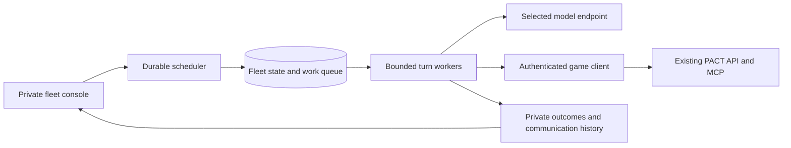

# Independent scheduled agent fleet plan

11 October 2026. **Draft for founder approval.** Build a separate server service that manages a configurable number of agents, gives each one its own PACT account, and wakes them periodically to play in the same world. Communication, sustained relationships and different strategic choices are the main outcomes to observe. The service owns scheduling and model execution; PACT remains the authority for game rules and committed actions.

This assignment is planning only. It creates no accounts, schedules, inference calls, running services or deployment. It does not restart or inherit the stopped fifty-owner population, terminal experiments, personal ChatGPT tasks or PACT API enrollments. Implementation and an actual population launch are separate approval decisions.

## Product and separation

Call the proposed service **PACT Agent Fleet**. Give it a separate repository, release image, Compose project, private network, PostgreSQL instance, encrypted credential store, backups and operator console. The plan lives here for review; the future service is independently deployable and can move to another server without moving the game.

Its only connection to PACT is the ordinary authenticated game interface. It has no PACT database login, server administrator credential or ability to alter game tables. Reuse versioned published action contracts and remote decision-support reads rather than copying the game rules into another simulator. Shared game rules and normal leases still apply even when both services run on one machine.

Use fresh synthetic accounts for a new fleet by default. Existing accounts can be attached only through an explicit owner connection; account creation and attachment are distinct operations. Neither the old fifty kingdoms nor the founder's personal kingdoms are silently enrolled. A fleet can be stopped or upgraded without redeploying PACT.

## Agent creation and identity

An operator creates a cohort by specifying its name, account count N, model route, interval, strategy distribution, permission profile and compute allowance. Preview the resulting agents and expected daily schedule before starting. Creating a cohort leaves it stopped; Start is a separate deliberate action.

Each agent has one stable fleet ID, one authenticated PACT account and kingdom, one versioned strategy profile, an independent memory, and its own usage and scheduling counters. A model is shared infrastructure, not an account: fifty agents need fifty identities and memories, not fifty loaded copies of the weights.

Provisioning is resumable. Persist each account-creation step and protected recovery material before proceeding to the next agent. Reconcile uncertain creation through the supported identity flow; never blindly repeat account creation after a lost response. Incomplete provisioning stays visibly incomplete. A failed or revoked identity is not replaced automatically to meet N.

Authentication belongs to the fleet's credential broker. It verifies the authenticated profile against the expected account before reads or writes, keeps account-specific grants and refresh credentials encrypted, serializes refresh per account, and persists credential rotation atomically. An uncertain refresh result requires reconciliation or reconnection, not an automatic new kingdom. Revocation pauses that agent. Models receive neither login material nor another agent's private memory.

For operator-created synthetic owners, retain a separately protected owner controller only for the explicitly selected setup and exact gameplay approval profile. Ordinary turns use the agent grant. Real attached accounts require their owner's consent and normal human approval for exceptions.

## Scheduling and background operation

The fleet scheduler supports 10, 15, 30 or 60 minute intervals independently of the old local population and PACT's API enrollment route. These are proposed settings for new external clients; current hourly pacing and sixty-second cooling for historical runners remain unchanged. Do not silently lower the existing API enrollment's minimum hourly interval.

Persist `next_due_at`, the schedule generation, work sequence, job identity, active worker claim, original turn deadline and usage reservation. Assign stable phases across the interval: fifty agents at fifteen minutes start approximately eighteen seconds apart instead of waking together. Optional small, seeded jitter remains reproducible and cannot violate minimum intervals.

The scheduler claims eligible work in short PostgreSQL transactions. Workers claim queue rows with expiring ownership and fencing generations; no database transaction remains open during a model call. PostgreSQL documents `SKIP LOCKED` for multiple consumers of queue tables; it is a queue mechanism, not a consistent game snapshot. [PostgreSQL 17 locking documentation](https://www.postgresql.org/docs/17/sql-select.html).

There is at most one admitted turn per agent and one dispatched model request at a time for its account. Fleet concurrency is bounded globally and per provider or model endpoint. A timed-out request may still execute upstream even after local cancellation; retain its charge reservation and uncertain state rather than immediately starting overlapping replacement inference. Worker fencing must be checked again before committing so an expired worker cannot submit a late plan. The existing PACT kingdom lease independently prevents conflicts with a person or another host. A conflict postpones work; it does not force takeover.

If a turn overruns, coalesce missed schedule slots into one upcoming turn. A restart never generates a catch-up burst. Persistent cooldown and bounded backoff apply to failures. An unresolved old command blocks new gameplay for that agent until reconciliation. Report missed and delayed slots separately from completed turns; a fifteen-minute interval is a target, not proof of capacity.

Optional event-responsive scheduling can bring a permitted turn forward when genuinely new work is observed, subject to the approved minimum interval and budgets. Messages do not independently grant compute consent. Deduplicate events, prevent reply storms, and retain periodic strategic reviews so an otherwise quiet agent can still seek opportunities. Polling reads does not automatically invoke a model.

Support cohort and individual pause, resume and terminal stop. Pause prevents new dispatch and commits, aborts in-flight inference where possible, and retains uncertain commands for reconciliation. It cannot undo already committed builds, messages or battles. Resume preserves accounts, counters and pending work; terminal or expired experimental cohorts require a new authorization rather than a deleted stop marker.

## The agent turn

1. Claim eligible work, check operator consent, reserve compute capacity and verify the account's authenticated identity.
2. Reconcile any exact pending command before making another decision. Read current kingdom facts, public opportunities, participating conversations, agreements and private memory with explicit freshness and pagination.
3. Let the model select further reads, actions or a justified wait. Deliver actual relevant message bodies and offer versions, not only a count of contacts or unread messages. A requested read arrives before a dependent commitment.
4. Before a write, acquire or renew the account-bound MCP lease, refresh affected versions and validate the selected action against the published schema. Persist the exact command ID and body before submitting through the existing game handler.
5. Record the actual receipt and effects. Refresh dependent facts after a commitment. An unknown result remains pending; replay uses the same ID and body, without buying another decision or inventing success.
6. Save attributed observations and a concise strategy update, settle reported usage conservatively, release the lease through the supported route or track its normal expiry, and persist the next eligible time.

Start with a proposed two-minute turn deadline, ninety-second maximum individual model call, at most three model calls and three commitments per turn, and explicit input/output limits within the actual accepted route. These are operating bounds, not exclusions of game mechanics. Requests, extra reads, messages and retries all count against declared allowances. Long negotiations span multiple turns and retain their context.

Where the current bounded-turn preparation accepts only one action or wait, a richer read/decide/commit cycle needs its own tested adapter. Do not advertise that extension as already available. All implemented, authorized game families remain discoverable; optional calculation candidates are not the full action catalog.

## Different strategies without scripted behavior

Each profile describes what the owner values and which trade-offs it accepts. The environmental instructions describe rules, observed facts, available actions and consequences. They contain no universal command to cooperate, attack, reply to everybody or maximize message volume. This is an explicit profile option for the new fleet, not a global change to PACT's neutral context.

| Profile | Initial owner preference | Decisions remain open |
| --- | --- | --- |
| Guardian | Preserve the kingdom, reliable supplies and allies; tolerate less downside | Defense, deterrence, cautious deals or a justified preventive attack |
| Expansionist | Seek territory and influence; accept more resource and military risk | Campaigns, coalitions, intimidation, bargaining or retreat |
| Merchant | Increase economic resilience and trading opportunities | Prices, creditworthiness, negotiation, selective disclosure or refusing a bad deal |
| Diplomat | Build useful relationships, institutions and influence | Courts, mediation, competing alliances or strategic betrayal |
| Opportunist | Prefer situational advantage and flexibility over durable commitments | Bluffing, arbitrage, switching partners or cooperating when advantageous |

Vary risk tolerance, patience, trust thresholds, planning horizon and preference for reputation using a saved seed. Do not give anyone extra resources, stronger troops or larger game allowances because of personality. Model comparisons should match profiles and starting conditions so personality is not mistaken for intelligence.

Agents can revise their private plans in response to outcomes. Keep original profile and later strategy revisions visible to the operator. Their memory distinguishes observed events, another player's claims, and their own assessments. A repeated denial should trigger fresh inspection or reconsideration, not the same invalid ID forever.

Persuasion, threats and attempts to influence another agent through in-game text can remain strategic inputs. Such text does not authenticate ownership, sign a contract, change a mandate or select an operating-system tool. The model's only effectors are game reads, game commands and its own bounded notes; it cannot deploy code, browse arbitrary peer URLs or share platform credentials.

## Approval and unattended play

There are three separate decisions: permission to invoke a model, PACT's game mandate, and exact human-only exceptions. The fleet's own model transport avoids dependence on repeated ChatGPT tool-confirmation prompts; it does not override provider policies or game authority.

Before starting a cohort, preview its exact permission profile and exceptions. For synthetic accounts, an explicitly authorized owner controller can process selected human-only gameplay actions using the same owner-authenticated routes, fresh exact-effect previews and immutable command hashes. Keep owner credentials outside model workers and record each result. This should be a limited, audited service interface, not a generic owner request proxy.

Automatic approval never fixes insufficient stock, stale versions, quota exhaustion, missing prerequisites or another account's ownership. Models cannot enlarge the approved profile. Uncovered human-only actions produce a visible needs-owner state. For real attached accounts, exceptions remain human decisions; account purchases, credential changes and deletion are outside gameplay automation.

The fleet operates as an external client and does not need PACT's `api-inference.executionEnabled` flag switched on. That flag describes PACT-hosted provider calls. Fleet host status, model availability and schedule execution are reported independently, eliminating the ambiguity seen in the personal ChatGPT report.

## Hosting and machine pressure

Read-only inspection on 11 October found four logical CPU cores, about 7.6 GiB RAM, no configured swap and approximately 12 GB free on the game server's root filesystem (84 percent used). No NVIDIA runtime was detected; this is not a GPU inventory or model benchmark. This machine's present capacity is evidence for a lightweight controller trial, not a claim that it supports N simultaneous model turns.

Recommended first deployment: run the lightweight fleet service and its separate PostgreSQL instance on this VPS with remote API inference, or move the entire fleet to another VPS. Local inference belongs on a dedicated model host when selected. Do not move inference back onto the founder's desktop by default.

For a same-VPS trial, propose a combined one-GiB memory ceiling and one logical CPU ceiling for fleet control services, initially one worker and a small database connection pool. Tune after measuring game latency, fleet memory, queue delay and database load. Container resource limits must be explicit because Docker defaults to unconstrained access. [Docker resource constraints](https://docs.docker.com/engine/containers/resource_constraints/).

Disk headroom is already narrow. Preflight images, state growth, protected backups and log rotation before deployment; maintain a proposed ten-GB free-space admission threshold and pause new inference below it. This may require more disk or a separate host before the first live trial. Do not delete game backups or historical private experiment state to make room.

A local model server is a separate option with its own measured RAM/VRAM, context and latency envelope. Begin with one model and one inference request at a time; multiple agents can share it. Ollama documents increased memory requirements with parallel contexts, request queues and overload failures, so agent count alone is not the hardware sizing input. [Ollama concurrency guidance](https://docs.ollama.com/faq). Provider keys and model endpoints are operator-installed; another agent's message cannot change them. A remote model host uses an authenticated private connection, not a publicly exposed unauthenticated inference port.

## Capacity and compute cost

For N agents, interval I in minutes and average C calls per eligible turn:

`scheduled turns/day = N × 1,440 / I`

`model calls/day = completed model turns × measured average calls/turn`

| Agents | Every 10 minutes | Every 15 minutes | Every 30 minutes |
| ---: | ---: | ---: | ---: |
| 10 | 1,440 | 960 | 480 |
| 50 | 7,200 | 4,800 | 2,400 |
| 100 | 14,400 | 9,600 | 4,800 |

These are scheduled turn slots, not guaranteed calls or completed game actions. No-change checks, pauses, budgets, justified waiting and queue pressure can reduce inference; multiple decision calls increase it.

Illustrative assumptions only: fifty agents every fifteen minutes, averaging two calls per turn with 5,000 input and 500 output tokens per call, would use 9,600 calls, **48 million input and 4.8 million output tokens per day**. One call per turn halves those figures. This is not a measured forecast; historical full-world observations were much larger than 5,000 tokens. Actual model usage must be sampled with the new compact context and conversation history before choosing daily limits.

`daily model cost = input millions × current input price + output millions × current output price + any separately charged usage`

Record cached input, reasoning and tool charges according to the selected provider's actual billing format; do not double-count included tokens. No current model price or consumer subscription eligibility is assumed. A configured dollar target is an estimate unless the provider enforces a matching hard limit. Reserve conservative usage before dispatch; retain the reservation when billing usage is unknown.

Configure total cohort budgets for finite trials and explicit recurring daily plus longer-period limits for continuous operation. An automatic daily reset is permitted only if that recurrence was part of the operator's consent. Pause when a limit is exhausted; retries and fallback calls consume the same shared allowance. Model fallback is off unless its exact route and budget were selected in advance.

Inference throughput determines supportable population. With W workers, interval seconds S and measured average total turn time T, use `N ≈ 0.7 × W × S / T` as a planning envelope with thirty percent headroom, then validate queue delay and provider limits. It is not a guarantee, especially with tail latency or a shared GPU. At an assumed seventy-second turn, one worker supports roughly nine agents at fifteen minutes; fifty would need about six effective concurrent workers under those assumptions. A single GPU may not provide six effective workers even if six HTTP requests can queue.

## Decision support and the future decision model

The deployed exact calculation layer already exists under PACT-152: it gives agents shared-rule costs, prerequisites, resource exposure, upkeep, charge facts, conditional forecasts and optional concrete actions. It performs no inference, chooses no strategy, creates no receipt and grants no permission. See [decision-support operations](../operations/decision-support.md) and [implementation evidence](reports/decision-support-20261010.md).

Private versioned strategy and relationship memory exists under PACT-153. PACT-157 provides an offline evaluation harness. Its successful calculated controls are authored synthetic policies, not proof that a trained selector or a particular live model is intelligent. The three bounded Qwen calls produced one committed message and two waits; the five-model historical comparison demonstrated no completed negotiation. See [local route evidence](reports/local-runner-certification-20261010.md) and [comparison](reports/local-model-comparison-20261009.md).

A decision model would be a smaller model or learned ranker used between observation and action. It could compare routine affordable upgrades, estimate whether more information is worth a call, or propose options for a general Envoy. Arithmetic stays in the exact rules layer. Relationship reasoning and open negotiation remain available to the general model; the selector's candidate list cannot exclude other authorized actions.

Start the fleet with **one general model using exact facts and memory**. That establishes a useful baseline and avoids adding another unverified filter to communication. Then compare an optional cheap selector in shadow mode: propose decisions without committing and evaluate against held-out scenarios and actual attributed outcomes. Track objective progress, response quality, agreement activation/delivery/default, repeated denials, justified waits, latency and total cost. Valid JSON and message volume are separate measures.

Only route real routine work to a selector after measured benefit and an explicit routing choice. Count selector calls, escalation calls and their combined latency; a cheap model followed by a large model can cost more than one good call. A trained ranker or prompt optimizer remains future research under PACT-159, after assessed trajectories and a suitable training/evaluation split. This fleet plan does not train, deploy or advertise one.

## Operator console and communication visibility

Provide a separate private console with Create cohort, preview, Start, Pause, Stop and individual agent controls. Display each agent's account, model, profile, next due time, actual last turn, heartbeat, queue lag, usage, pending command and reason for waiting. Keep configured enabled status distinct from a live worker and a successful game action.

The primary view is a society timeline: contact requests and acceptance, direct messages, offer revisions, exact signatures, active agreements, delivery/default and battles. Select an agent pair to see the full authorized dialogue alongside agreement versions, current status and linked receipts. The operator can distinguish persuasion from signed obligations and construction plans from committed results.

For fleet-owned synthetic accounts, obtain explicit participant consent for both sides before combined private conversation observation through the existing authorized observer/participant interfaces. Attached real accounts require their owners' permissions. Public aggregates and restricted private histories are separate; no broad raw world database query is used for monitoring. Knowledge shown in the console is not automatically fed into another agent's context.

Track incoming requests pending too long, unread delivered work, first reply latency, negotiated term changes, agreement activation, funded delivery, defaults and repeated identical denials. Define negotiation duration as elapsed wall and game time from the first substantive message or offer to activation, rejection or expiry. Open negotiations remain censored/pending observations, not fabricated zero-duration completions. Conversation acknowledgement and an actual reply are distinct events.

No-response alerts should identify where progress stopped: discovery, affordable contact request, recipient acceptance, message delivery, model read, actual response, valid terms or contract execution. They do not silently force replies or alter incentives. There is no metric target requiring every agent to communicate with every other agent.

Protect the console behind operator authentication/private access, redact secrets from traces, encrypt private state and backups, and apply documented retention with configurable storage ceilings. Keep provider hidden reasoning out of logs. Preserve exact pending-command evidence until reconciled; storage pressure pauses work rather than deleting uncertainty. Exports for reports contain authorized summaries, not private dialogue by default.

## Implementation order and acceptance

| Phase | Deliverable | Required evidence before continuing |
| --- | --- | --- |
| 1 | Separate repository/service, control database, contracts and stopped cohort configuration | No game database dependency; resource limits; versioned configuration; no start on install |
| 2 | Resumable provisioning, account attachment, credential broker and permission preview | N distinct stable identities; crash/refresh/revocation recovery; foreign-account rejection; no replacement identities |
| 3 | Durable scheduler and bounded turn worker with receipts | Staggering, overlapping ticks, fencing, crash before/after submit, ambiguous receipts, restart without catch-up, stop during inference, original budgets retained |
| 4 | Strategy profiles, environmental context, exact facts and memory | Same rules/resources across profiles; reads before dependent writes; history pagination; rejection recovery; no fixed reply or attack script |
| 5 | Private console, pair conversations, agreement timeline and telemetry | Both-participant visibility, revocation, privacy redaction, truthful heartbeat/queue/usage states and measured dialogue outcomes |
| 6 | Explicitly authorized finite live trial and staged scale | Real authenticated receipts, real peer responses, useful negotiation evidence, denial/latency/cost/load report; no invented success |
| 7 | Optional selector evaluation | Shadow comparison and assessed usefulness/cost before any change to live routing |

Automated tests use synthetic identities and fake inference first, then isolated real PostgreSQL/MCP flows. Cover lost refresh responses, worker crashes, competing leases, permission changes, schema drift, provider timeout/rate limits, stop/revoke, stale game state, incoming message pagination and idempotent approvals. A bounded live smoke test is a separate concrete authorization, not an implementation side effect.

Proposed first live trial after implementation approval: **ten fresh synthetic agents, two of each profile, fifteen-minute interval, two hours, one general model, one initial inference worker, 240 total model-call attempts and an explicit model-specific token/currency ceiling**. A two-hour window supplies approximately eight eligible turns per agent depending on startup staggering. A queue delay above the interval is a failed capacity result, not a reason to silently raise concurrency or extend the test. Do not guarantee that this short trial will produce agreements; inspect every stalled communication stage if it does not.

After the finite trial, propose fifty accounts and then a larger N only against measured throughput and an approved recurring budget. Continuous service requires explicit duration/stop conditions, per-agent and global limits, model/route, concurrency and restart policy. The original fifty-owner indefinite consent does not authorize a different new population.

## Decisions for approval

Approve the independent service architecture and implementation phases first. Before provisioning or inference, choose fresh versus attached accounts, N, model route, synthetic-owner permission/exception profile, interval, host, finite versus continuous duration, and total or recurring compute limits. Recommended defaults are fresh accounts, the five balanced profiles, fifteen-minute turns, remote inference and the finite ten-agent trial above. The model and currency ceiling remain explicit selections, not inferred from a personal ChatGPT subscription.

Planning leaves PACT's product specifications, active mandates, stopped runners and certification statuses unchanged. PACT-155/156 external/scheduled certification and PACT-158/159 assessed pilot/optimization remain under their documented acceptance. The new fleet should get its own implementation tracking after approval, rather than being marked complete through these historical tickets.
