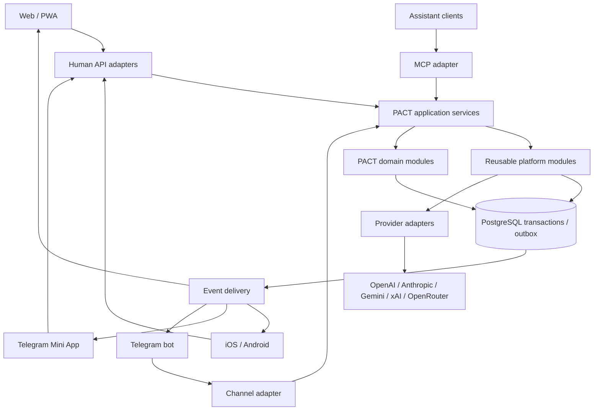

# Channels and reusable architecture

**Version 1.3 · 22 September 2026 · Owner of client coverage, module boundaries, and cross-channel behavior.**

## Product commitment

One account, one kingdom, one shared world, accessible through web, iOS, Android, Telegram, and supported assistant clients. These are different ways to reach the same game. Changing an app or model never creates extra resources, a second Envoy, additional action allowances, or separate progress. The zero-cost MVP validates web, Telegram, and assistant access first. Paid Apple/Google membership, signed physical-device certification, and complete native gameplay are deferred to the Season One release milestone after the game has been played and validated; the shared native shell remains preparatory work, not an MVP gate.

Version 1.1 adds native apps and Telegram to the first-season release scope. Web remains the first complete development client. Phase 0 proves authentication and one action on each new surface; phase 2 delivers functional mobile/Telegram play; phase 3 completes distribution and purchases. Native clients are now required, replacing the earlier PWA-only scope.

## Channel contract

| Surface | Player experience | Implementation |
| --- | --- | --- |
| Web / PWA | Complete dashboard, account, gameplay, Envoy, social, and shop controls | React web application |
| iOS and Android | The same core gameplay and account capabilities, native navigation, secure sessions, push, and deep links | One React Native application using Expo development builds; separate signed store releases |
| Telegram Mini App | The compact four-screen dashboard inside Telegram | Reuse the React web feature components, with a Telegram shell for theme, viewport, back navigation, and validated identity |
| Telegram bot | Private-chat briefings, explicit Envoy start/stop, notifications, and links to review/approve | Bot API adapter; important actions open the authenticated Mini App or PACT web view |
| ChatGPT / Claude | Tell the assistant to inspect, negotiate, and play; approve exceptions in PACT | Authenticated MCP tools and optional host-supported presentation |
| Gemini-compatible clients | The same tools from an MCP-capable Gemini client; Gemini CLI is a named certification target | Standard MCP adapter; no duplicate game implementation |
| Grok / xAI-compatible clients | Grok-powered Envoys in PACT and tool-capable external integrations | xAI model adapter plus certified tool/MCP client routes |
| Future clients | Integrate with documented commands, authorized views, and event cursors | Versioned HTTP API, TypeScript SDK, JSON schemas, and MCP |

React Native/Expo supplies an iOS/Android application framework; this is not a promise that React DOM components run unchanged as native views. Share contracts, API client, state logic, formatting, design tokens, and assets. Web/Mini App share DOM components; native screens use native accessible controls. [Expo project guidance](https://docs.expo.dev/get-started/create-a-project/).

**Model support and consumer-chat support remain different.** GPT, Claude, Gemini, and Grok are required model choices inside PACT, alongside OpenRouter. Gemini CLI documents MCP, and xAI documents remote MCP tools in its API. Those capabilities do not prove that every consumer Gemini/Grok app allows users to add an arbitrary game connector. Certify the actual client and advertise its tested route; retain PACT mobile/web/Telegram access to the model when a consumer host lacks that route. [Gemini CLI MCP](https://geminicli.com/docs/tools/mcp-server/), [xAI remote MCP tools](https://docs.x.ai/developers/tools/remote-mcp).

Subscription OAuth is an adapter capability, not an assumption shared by all providers. The compatibility work records eligibility, allowed integration, billing, scopes, and revocation. It cannot turn an OpenCode or Codex login into an unverified hosted-service credential.

## Architecture

Begin as a **modular monolith** in one TypeScript workspace with separately runnable API, game, inference, channel-delivery, and notification processes. Modules have clear interfaces but do not each require a network service. This retains atomic gameplay transactions while giving us packages that another product can use.

### Reusable platform modules

| Module | Public responsibility | Product-specific inputs |
| --- | --- | --- |
| Identity and sessions | Account verification, sessions, recovery, external identity linking, OAuth grants | Branding, policies, client registrations, scope definitions |
| Secret vault | Encrypted credentials, rotation, revocation, audit | Credential type, provider ID, product/account scope |
| Model adapters | Model discovery, request/tool conversion, usage, failures | Requested model and typed tools; no knowledge of kingdoms |
| Agent runtime | Explicit run lifecycle, token/call ceilings, exclusive lease, context assembly hooks | Objective, tool registry, context provider, domain authorization callback |
| Policy and approval | Versioned mandate, exact-command approval, bounded authorization reservations | Opaque subject ID, action schema, asset codes, resource/commitment checks |
| Communication | Threads, messages, contacts, audience and delivery abstractions | Contact/block policy, fees, limits, publication policy |
| Events and notifications | Durable outbox/inbox, cursors, subscriptions, preferences, channel dispatch | Event schemas, visibility, templates, urgency and grouping rules |
| Evidence | Canonical signing, key publication, verification and removal status | Authorized source selector and evidence payload schema |
| Commerce | Catalog, purchase receipts, entitlement provenance, refund adapters | Cosmetic product IDs, localized prices, source-specific spending policy |
| Privacy and audit | Retention registry, exports, erasure orchestration, restricted holds, staff audit | Domain cleanup/export hooks and legally configured retention classes |
| UI foundation and client SDK | Tokens, resource/status formatting, request client, event subscriptions, feature capability negotiation | Product view models and surface-specific presentation |

These modules must not import PACT building types, troops, Fortune, Courts, or season constants. Interfaces use generic `Principal`, `ProductScope`, `SubjectRef`, `Action`, `Receipt`, `Event`, and `Entitlement` types. Reuse means installing a versioned package and supplying adapters, not copying a directory and editing hard-coded PACT names.

### PACT-owned domain modules

Kingdom development; resources and provenance; troop ownership and training; supply/garrison contracts; scouting and combat; Courts/Articles/allegiance; Chronicle publication; seasons/Fortune/achievements. The deterministic rules core is pure computation. PACT application services coordinate these domain modules with the reusable authority, identity, and transaction interfaces.

Game resource balances and future-spend permissions remain distinct ledgers. The command service commits both in the **same unit of work**. A contract signature cannot reserve permission in one transaction and spend its bond in an unrelated eventually consistent service. Domain-critical invariants stay synchronous; notifications, analytics, and public read projections use committed outbox events.

### Dependency and data rules

- Platform code depends only on shared contracts and injected ports. PACT depends on platform interfaces; transport/UI adapters depend on application contracts. No reverse import from platform into PACT.
- Each module owns its migrations, tables, indexes, retention registration, and repository access. Other modules use public interfaces; no arbitrary cross-module SQL or shared mutable entities. Transaction-bound repository handles can participate in one coordinated transaction without exposing tables.
- Cross-module queries use authorized view builders or projections. Projections carry source versions and are never used to approve a spend against stale state.
- Every account credential, session, job, event, and entitlement carries an explicit product scope. PACT initially has one world scope. Future products get isolated registrations, secrets, namespaces, and configuration; shared packages do not automatically share player data or wallets.
- Use explicit package exports, semantic package versions, versioned event/schema names, and generated client types. CI rejects forbidden imports and breaking contract changes without a version/migration plan. Inject clock, randomness, secrets, storage, provider, delivery, and billing ports.
- Do not build a universal plugin marketplace, arbitrary code loading, or a generic game editor. The extraction test is a small non-game fixture using identity, runtime, approvals, and notifications without importing PACT modules.

## Sessions, linking, and approvals

Email/password remains the recovery and ownership identity. Native apps use the system browser for the PACT first-party authorization flow with PKCE S256, registered app/universal links, audience-bound 15-minute access tokens, and rotating refresh credentials with the existing 30-day absolute lifetime. Store refresh credentials in OS secure storage; access tokens stay in memory. Never store a user's password or model key in mobile preferences. The first-party human audience can approve; the MCP agent audience cannot. Every sensitive change still requires recent human reauthentication.

Telegram is an explicitly linked identity, not automatic ownership inferred from a username. The initial link requires an existing verified PACT login (or completing PACT signup), a server-validated Telegram identity, an expiring single-use challenge, and a confirmation displaying both accounts. One Telegram user ID links to one PACT account and vice versa in this release. Changing a Telegram handle does not change that mapping. Unlink revokes its channel sessions and subscriptions and stops new work in runs initiated through that channel, without deleting the kingdom or reversing committed game jobs.

Validate Mini App `initData` on the server using Telegram's documented algorithm, bind it to our bot, reject data older than five minutes, and reject replayed bootstrap exchanges. Never trust `initDataUnsafe` as proof. Issue an audience-scoped short session; keep it in memory and use a fresh validated launch to renew. Bot webhook secret validation and update-ID deduplication are separate checks; a forwarded message is not authentication. [Telegram Mini App validation](https://core.telegram.org/bots/webapps#validating-data-received-via-the-mini-app).

On mobile, approve in the native authenticated sheet. In Telegram, open the authenticated Mini App approval sheet; approval is not a callback button in arbitrary chat text. Both send the same human-authenticated exact-command POST as web. A second approval from another device receives the existing receipt. Changed terms, expired deadlines, revocation, and account closing are checked at commit.

Version 1 bot use is private-chat only. `/world`, `/inbox`, and `/status` return authorized factual summaries; `/stop` cancels future Envoy work. `/run` or a free-text objective creates a preview showing the selected model and allowance. A single-use, account-bound **Start run** callback confirms this specific objective and bounded run. It cannot silently resume later or accept an old forwarded button. Unknown prose never directly transfers resources or approves an exception. API keys/passwords are entered only through the secure PACT connection flow, never requested in a Telegram message.

## State and handoff

All clients read server snapshots with a version and consume the same event stream. A command retains its command ID on transport retry; a client must not manufacture a new ID merely because it timed out. Event consumers deduplicate and refetch on expired cursors. Surface-specific UI state can differ, but resource totals, receipts, approval versions, and run status cannot.

There is still one Envoy write lease per kingdom. Opening mobile while a chatbot is working shows the current run; it does not spawn another. The human can stop/take over deliberately. Human manual commands retain normal game limits and invalidate stale proposals when appropriate. Push delivery, bot replies, app launch, and reconnect never start a model run. Backgrounding a mobile/Mini App behaves like closing the web page: a previously started server run may finish within its original allowance.

Offline clients display cached state as stale and disable commitment. They may keep an unsent objective or UI draft locally, but must review it against fresh state on reconnect. Do not queue raids, signatures, purchases, or approvals for blind offline replay. Deep links identify a destination; they carry no reusable approval credential.

Notifications use Web Push, APNs, FCM, Telegram bot delivery, and email adapters. Preferences are per account/category/channel. In-app history always persists; each opted-in external channel receives at most one grouped event delivery under its deduplication key. Expired device tokens and Telegram blocks disable that endpoint. Security and gameplay state never depend on notification success.

## Purchases and privacy on every surface

Maintain one account cosmetic entitlement ledger with purchase-source provenance. Web uses hosted checkout; iOS uses StoreKit in-app purchases; Android uses Google Play Billing; Telegram uses Stars. These are conservative release choices rather than assertions that every region prohibits alternatives. No surface embeds the web payment flow to bypass its distribution rules. Recheck current platform rules during release certification. [Apple review guidelines](https://developer.apple.com/app-store/review/guidelines/), [Google Play payments](https://support.google.com/googleplay/android-developer/answer/9858738?hl=en).

Telegram requires Stars for digital goods sold inside bots/Mini Apps. Verify `successful_payment` server-side; invoice creation and pre-checkout acceptance alone never grant Gems. Deduplicate by platform and payment ID; reconcile refund/chargeback events through the same commerce interface. [Telegram digital-goods payments](https://core.telegram.org/bots/payments-stars).

Keep earned Gems shared. Record paid Gems as platform-origin lots; initially spend a paid lot only on its originating channel, with earned Gems available everywhere. Show **Available here** separately from other-channel paid balances. Unlocked cosmetics belong to the PACT account and are available on supported surfaces; the same sale catalog is offered through each native purchase route. This conservative purchase policy preserves receipt/refund attribution and avoids assuming portable paid currency is accepted everywhere. Entitlement restore reads server-verified receipts; it must never re-credit a consumed Gem pack from a client replay. App-review requirements remain release acceptance work.

Privacy coverage includes device push tokens, Telegram numeric IDs/chat IDs, channel sessions, and platform receipts. Keep links while connected; disable immediately on unlink and purge live identifiers/tokens within 24 hours. Backups and narrowly held audit records follow the existing privacy policy. Raw Telegram webhook payloads are processed then discarded; retain only deduplication IDs for 24 hours and the normalized authorized objective/event under its existing retention class. Telegram-delivered messages are visible to Telegram and the user; PACT cannot promise to erase their copies. Do not collect address books, phone numbers, location, or contact discovery for these integrations.

## Proof that it is modular

Before the rules milestone closes, a small non-game test application must import the reusable identity, model/runtime, approval, and notification packages and complete a synthetic action/approval cycle using in-memory adapters. It must compile without the PACT domain or production database and leak no state across product scopes. Separately, PACT must still commit a real game action and its authority reservation atomically. Both checks are required: independent reuse and correct integrated transactions.

Before launch, repeat the same account → objective → offer → approval → receipt → revoke flow across web, iOS, Android, Telegram, and certified assistant routes. Cross-device races, out-of-order notifications, account unlink/deletion, stale app versions, payment replays, and provider outages belong to the acceptance suite.
