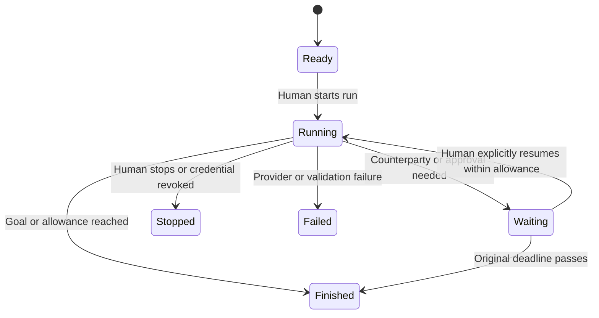

# Execution contract

**Version 1.1 · Owner of Envoy execution, authority, approvals, notifications, and service architecture.**

[Architecture](architecture.md) owns reusable package boundaries and channel adapters. Web, native apps, Telegram, and MCP use these same application services; native human sessions and validated Telegram run requests do not create additional Envoy allowances.

## Who does the work

| Component | Responsibility |
| --- | --- |
| Human | Uses any authenticated PACT client to set goals and limits; approves exceptions; owns account, purchases, and publication |
| PACT app inference worker | Calls the player's selected provider during an explicitly started, bounded run |
| External chatbot | Supplies its own inference and decides when to invoke authorized MCP tools |
| Rules service | Validates and commits actions, production, upkeep, contracts, and combat; never reasons or negotiates |
| Scheduler and notification worker | Settles predetermined game work and records/delivers events; never starts an LLM call |

PACT runs player-key inference in its own application. This replaces the historical external-assistant-only design. It does not provide a continuously thinking Envoy. An inbox item, new raid, cron tick, or unsolicited delivery webhook cannot authorize a new inference run. A verified, explicit human Start run confirmation delivered through the Telegram adapter is an authorized start request, subject to the same one-use and allowance checks as web/native.

## Run lifecycle

In PACT web, native apps, and the Telegram Mini App, **Start Envoy** submits an objective and visible limits through the human session. A linked Telegram private-chat request uses the single-use objective/allowance confirmation in [architecture](architecture.md); an incoming event or arbitrary chat message cannot silently start inference. Defaults: **15 minutes, six selected conversations, 12 outgoing messages, 20 model calls, and 40,000 total reported tokens**. The player may select up to 12 conversations and 24 messages within unchanged kingdom limits; time, call, and token ceilings remain fixed in Version 1. One model request is in flight per kingdom. Batch independent tool requests from that response transactionally as separate commands.

Before each provider call, bound input to the remaining allowance and set an output ceiling no greater than 2,000 tokens or the remaining allowance. Reserve estimated input plus that output allowance before dispatch; reconcile using provider-reported input, output, and charged reasoning tokens after completion. Missing usage retains the full reservation. The estimate can differ from the provider's bill; it is not a guaranteed currency cap. Costs and use appear in the run receipt. No additional call begins when any limit is exhausted.

Waiting releases the worker; it does not poll a model. A new inbox message produces a notification, not automatic inference. A person resumes the run or begins another. Resume preserves the original deadline and consumed allowances. **Approve** executes only the exact approved command; **Approve and resume** additionally requests resumed model work while allowance remains. Neither action extends the deadline.

Closing the browser does not cancel a PACT run already requested: the server finishes within its original bounds. A queued build, training batch, signed agreement, scouting order, defense, or raid also continues according to the rulebook. Closing an external chatbot may stop that host's inference immediately; PACT cannot extend its subscription session. Committed game commands survive both cases. Stop/revoke prevents new command admission; work already committed has normal game consequences.

For MCP, `run.open` obtains a 15-minute write lease under the user's previously granted mandate. PACT does not invoke the host or control its inference lifetime. Host-scheduled agents and scripts, if a user runs them externally, are treated as external clients under the same limits; PACT cannot truthfully certify that every authenticated tool call came from a person reopening a chat. PACT itself provides no scheduled inference or paid presence feature. External host usage is shown as **Usage managed by your chatbot**, never as measured API spend.

Only one write lease exists per kingdom across PACT, MCP, and scripts. Read-only clients may coexist. A second client gets `RUN_ALREADY_ACTIVE`; the human can stop/take over in PACT. Expiry, explicit stop, or revocation releases the lease. Authentication alone does not create it. Renewal never raises authority or replenishes rolling gameplay allowances.

## Human authority

The human edits a versioned mandate in PACT. It contains allowed actions, optional target/contact restrictions, per-resource spending limits, protected reserve floors, troop commitment limits, and session limits. The model receives a readable copy but cannot change it. Agent language cannot override server rules. Default reserve floors are zero; the setup screen recommends an explicit Grain reserve before exporting.

| Action | Initial authority |
| --- | --- |
| Read permitted state, reports, and inbox | Allowed |
| Message accepted contacts; draft/counter an offer | Allowed within communication limits |
| Spend resources; sign a binding agreement; train/build; cold-contact; scout | Requires human approval until enabled with a nonzero mandate allowance |
| Raid, join a raid, lend/recall/return troops, break a contract | Disabled until individually enabled; still subject to reserves and commitments |
| Seize another player's troops | Human approval for every occurrence |
| Publish a Seal, Article, public post, or allegiance; change Court roles | Human approval for every occurrence |
| Raise authority, connect credentials, buy, delete/export account | Human-only; not MCP tools |

The human may act manually without an agent allowance, but normal stock, troop, charge, and rolling action limits still apply. A manual exception never silently enlarges future agent authority. Raising reserve floors previews contracts that would default; applying the change is an explicit human decision.

### Authority ledger

This is an **authorization ledger**, separate from available resource balances. Keep exact internal resource units, one ledger per kingdom/resource, shared by every connection.

For each resource, enforce `spent_in_last_24_game_hours + reserved_future_outgoing <= mandate_limit`. Incoming payments never offset this check. Expected trade profit is not spendable authority. A reserve does not escrow game stock, guarantee production, or protect resources from a raid.

- Nonbinding offers and counteroffers reserve nothing. At an agent's signature, reserve its entire remaining promised outgoing supply, bond, or immediate cost. A signed offer holds this reservation until activation, replacement, expiry, or withdrawal. Activation reuses it, never doubles it.
- Standing contracts reserve **all** unpaid outgoing installments through the signed end, not just the next day. This deliberately requires a larger allowance for a longer commitment. The first-side signature expires with its offer; the second signature cannot activate against an expired reservation.
- Posting a bond moves its amount from reserved to spent when stock leaves the wallet. A later bond return does not refund spent authority. The same rule applies to construction cancellation refunds and failed commercial bargains.
- An agent-queued building instruction reserves its full price as ordinary-resource authority at queue admission without reserving stock. At actual start, recheck mandate version, action permission, reserve floors, funds, and prerequisites, then convert the actual ordinary-resource debit to spent and release any difference covered by a founding allowance. If the current mandate no longer permits it, show **Approval needed** and leave it unstarted. Canceling the waiting instruction releases its reservation. Human-queued instructions use an exact human permit. Restricted construction allowance is never charged as ordinary-resource spending.
- Each settled installment moves the **actually debited** amount from reserved to spent at its tick timestamp. Default, notice expiry, mutual release, or ordinary expiry releases undelivered future reservations. Incoming credit and default compensation do not replenish allowance.
- A garrison commitment reserves the host's specified maximum normal upkeep for its duration, plus a five-minute defensive-lock extension, when the agent signs. This is an authority exposure reservation, not escrow and not a second upkeep debit. Each actual visiting-upkeep debit consumes it. Recall/return releases the remainder. After an exit is pending, those units cannot enter new locks, so the extension is bounded. Hunger/desertion reduce future actual debits.
- Recurring ordinary army upkeep is a consequence of troop ownership, not a new autonomous purchase every minute. Training/accepting troops requires the relevant action and troop cap. Show future upkeep separately; do not charge it again against supply-export limits.
- All mutations lock the relevant authority and resource rows. Two clients signing at once cannot each use the same allowance. Lowering a mandate below existing exposure succeeds, disables new automatic spend, and lists existing obligations; it does not silently default them. Existing signed reservations remain valid until their defined end.
- Human-approved exceptions create an exact one-use permit and a separately labeled exposure record. Their future installments are not retroactively tested against an insufficient agent allowance. Normal export reserve floors still apply. This prevents an approved contract from instantly failing solely because the exception did not change the mandate.

Units use identity-based commitment reservations. An agent cannot meet a troop limit by splitting one order into many small orders. Aggregate live commitments across all clients and actions. Authority checks run again at command commit, including a changed mandate version.

## Approval inbox

A blocked proposal creates an immutable approval request with `approval_id`, canonical command hash, exact terms/version, effects, relevant state preconditions, requesting client/run, creation time, and expiry. Expiry is the earliest of **15 minutes**, the offer expiry, and any relevant action/lock deadline. The MCP response includes a PACT deep link and plain-language summary.

The human opens that link in web, a verified native app link, or the Telegram Mini App, signs into PACT if necessary, and reviews the exact server-rendered effects. The same first-party human authorization check applies; a bot message callback is not an approval. A URL contains an opaque request ID, not an approval bearer secret. A GET never approves. A human-authenticated POST commits the one approved command atomically after checking current stock, permissions, versions, targets, and time. Duplicate approvals return the original receipt. Changed terms invalidate the approval and require a new request. An unavailable or expired action cannot be revived by approval.

The result appears in the shared inbox and in `approval.status`; it does not require the model to remain connected. The agent may later read that result. Rejection, expiration, and revocation also have explicit receipts. An external host's “Yes, allow tool” dialogue is distinct from this game-authority approval.

## Notifications and absence

All relevant events enter a durable, cursor-addressed inbox. App live views use SSE where supported; mobile clients and MCP also have bounded cursor polling through the same event contract. Telegram delivery is an external notification adapter. Offline clients pull the same events on return. Network reconnect resumes after the last acknowledged event. Events carry game timestamp, actual UTC timestamp, event type, actor, visibility, and related record ID. Push delivery is advisory; the persisted inbox and server clock determine state.

| Event | Delivery policy |
| --- | --- |
| Raid declared, approval requested, contract default, starvation starts | In-app always; email, Web Push, native push, and Telegram delivery independently opt-in during onboarding |
| Building/training complete, ordinary reply, contract nearing expiry | In-app; optional grouped push, no default email |
| Password reset, email change, new MCP grant, deletion request | Transactional security email; no promotional material |
| Likes, views, rank fluctuations | No push/email |

Send the first critical event promptly. Group additional events of the same category for the same kingdom within ten minutes and link to the full inbox. There is no promised five-minute offline raid reminder; show the lock countdown in an open operation view. Queue/retry delivery cannot delay combat or grant an offline shield. Notifications say that action is available; opening one does not start a model or approve a command. Sensitive amounts and message text are excluded from lock-screen/email previews.

## Common command contract

Web, native apps, Telegram adapters, provider adapters, and MCP use one command handler. Transport authentication maps to a scoped principal; external agent credentials can never invoke a human approval route. Each write includes a UUID `command_id`, `kingdom_id`, `run_id` when agent-originated, `mandate_version`, an action name, typed payload, and relevant record versions. The server derives actor identity and permission from credentials; payload fields cannot impersonate an owner.

Canonical command groups are `building`, `training`, `contract`, `transfer`, `scout`, `garrison`, `raid`, `contact`, and `publication`. MCP exposes these alongside `world.read`, `inbox.read`, `record.read`, `message.send`, `run.open`, `run.stop`, `approval.status`, and `receipt.read`. Their schemas enumerate only supported primitives, never executable code or an unrestricted query language. Every balance is an integer in 1/600 units; every reported assumption and interpretation is labeled separately from a record.

Receipts contain command ID, result code, committed event IDs, current record versions, exact charged resources/limits, and any approval ID. Codes include `COMMITTED`, `ALREADY_COMMITTED`, `APPROVAL_REQUIRED`, `STALE_VERSION`, `INSUFFICIENT_STOCK`, `RESERVE_FLOOR`, `UNIT_LOCKED`, `RATE_LIMITED`, `EXPIRED`, `FORBIDDEN`, and `WORLD_PAUSED`. A retry with the same ID and canonical payload returns the receipt; reuse with a changed payload returns `IDEMPOTENCY_CONFLICT`. Persist receipts for 180 days. A client must reconcile an uncertain old write from history instead of retrying beyond that window.

Multi-party acceptance validates all signatures, capacity, reservations, and bonds in one database transaction. Outbox events commit in that transaction. No network call or model generation is inside a database transaction. An invalid model action fails without spending game resources; it is an error to report, not a new rule to improvise. Transport-abuse throttles still apply to repeated rejected commands.

Third-party messages are untrusted game content. The run can cite and reason about them, but cannot execute their instructions as system authority, fetch their arbitrary URLs, reveal private prompts/credentials, or expand its tools. Published accusations remain claims. No tools expose model keys or hidden reasoning. Agent summaries are generated only within a requested inference run; the offline service can build factual summaries from events without an LLM.

## Deployment contract

Use a TypeScript modular monolith: **Node.js 24 LTS**, React web/Telegram UI, React Native with Expo for iOS/Android, Fastify HTTP service, and **PostgreSQL 17** as the transactional authority. These are supported release lines at the specification date. Pin dependency patch versions in the implementation lockfile at bootstrap. Separate API, rules worker, inference worker, and notification worker processes from the same repository. Game tables, authority reservations, durable jobs, and the transactional outbox live in PostgreSQL; no Redis dependency is required for correctness. [Node.js release schedule](https://nodejs.org/en/about/previous-releases), [PostgreSQL support policy](https://www.postgresql.org/support/versioning/).

Host in AWS Frankfurt: ECS/Fargate services, RDS PostgreSQL with Multi-AZ and point-in-time recovery, private S3 for exports, KMS for envelope encryption, and SES for transactional email. CDN caches only public static assets and intentionally public pages; never private API responses. Use per-environment accounts, TLS, secret rotation, least-privilege worker roles, and infrastructure as code. Production and test worlds have separate credentials and databases.

One elected world worker advances the authoritative game clock under a database lease. Tick phases follow the [rulebook](rules.md). Prepare large-tick calculations against a committed snapshot; publish the new tick atomically before admitting commands against it. Workers lease jobs with uniqueness keys, and every settlement is replay-safe. Outbox delivery is at least once; consumers deduplicate.

A rules heartbeat delayed more than 60 seconds, loss of the authoritative database, or a fault making committed outcomes unreliable suspends the world at the last committed minute. Freeze production, upkeep, game deadlines, charge regeneration, and game action windows together. On recovery, resume from that minute and shift displayed UTC forecasts by the pause duration; do not catch up hours of starvation. Season weeks use this same paused game clock. Account security expiries and data retention continue in real UTC. A model-provider failure, email failure, or one player's disconnection does not pause the world.

Retain ordinary operational backups for 35 days. Verify restore, outbox replay, revocation, and deletion suppression before admitting players. Operational objectives are p95 state reads under 500 ms and command receipts under one second at the social-slice test load; provider reasoning latency is reported separately. These are acceptance targets, not measured performance claims.
