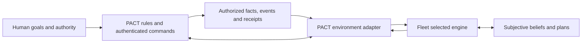

# PACT and Fleet: game-side project guide

**Evidence checkpoint: 19 October 2026.** This guide explains the game half of the project, its relationship to Fleet and the difference between design, source verification and live acceptance. It does not change product behavior, authority, deferred tasks or deployment state.

PACT is a competitive persistent kingdom game. A human owns a kingdom, chooses priorities and grants bounded authority to an Envoy. Other kingdoms can become trading partners, allies, competitors or threats. Relationships are chosen rather than prescribed; the game enforces resources, ownership, deadlines and authenticated actions.

Fleet is a separate repository/database/service that runs authorized agents. It preserves the original loop while adding alternative engines and environment contracts. The purpose is useful gameplay; optional comparisons and reports help us decide which implementations work. No agent receives human credentials or the ability to approve its own exception.

## Publication scope

This documentation-only publication includes the technical narrative and dated source evidence. It does not merge the paired PACT/Fleet implementation branches. Newer candidate API protocols and code maps therefore describe locally verified source, not an assertion that `master` or a deployed host already exposes them. Canonical specifications and the active tracker on the published branch remain authoritative.

## Read this together

| Topic | Source |
|---|---|
| Combined project story, diagrams and presentation notes | [Fleet project handbook](https://github.com/safa-safakhou/fleet/blob/master/docs/project/README.md) |
| Game source/process/authority map | [PACT technical architecture](architecture.md) |
| Product and paired implementation journey | [PACT journey](journey.md) |
| Normative rules and document ownership | [Canonical specification index](../pact/README.md) |
| Product promise, screens and progression | [Product brief](../pact/product.md) |
| Exact economy, contracts, combat and timing | [Rulebook](../pact/rules.md) |
| Human/model/grant identity and execution | [Access](../pact/access.md), [runtime](../pact/runtime.md) |
| Society, evidence, conduct and privacy | [Social](../pact/social.md), [privacy](../pact/privacy.md) |
| Scope/dependencies and original acceptance reports | [Implementation workflow](../implementation/README.md), [report catalogue](report-catalog.md) |

## What is delivered and what is not established

The scoped Alpha, generated web experience and friends test were implemented. The 4 October population experiment exercised actual development, messages and contracts with 10 Luna agents plus 90 scripts. Later projects delivered communication/discovery/reliability improvements under their own scopes. Those achievements do not automatically close the original 24 deferred production tasks, every consumer-host/device certification or all broader release requirements.

PACT P1/P2/P3 supply source-verified event metadata, factual outlook and consequence scenarios/playback for Fleet's newer engines. Paired acceptance exercises actual game handlers with synthetic principals. It does not establish deployed event/outlook activation, hard real-time behavior or strategic competence.

Latest Fleet diagnostics found 0 modern memory writes,4 legacy memory records, a reproduced next-turn retrieval omission and valid JSON containing bad reserve arithmetic. The game mechanics and software structures exist; dependable agent use of them remains a separate gap. [Detailed findings](https://github.com/safa-safakhou/fleet/blob/master/docs/project/findings.md).

## Survival and relationships without forced behavior

Scarcity, upkeep, threats, costs and obligations can make communication or alliance useful. They can also make refusal or silence sensible. The source design exposes relevant authorized facts and lets the agent choose under existing authority. It does not award strength for purchases, prescribe an alliance, set a universal trust score or claim consciousness. A promise, fulfilled help and a later lost battle remain distinct facts.

The proposed fresh world with 100 Luna kingdoms and local engine groups is not a launched population. Safe world identity/transition, cross-host enrollment, exact route budgets and throughput remain prerequisites. Recent work did not reset the game, change server Fleet or resume historical experiments. Publishing source is not deployment or execution authorization.

## Sharing

Use the linked handbook, aggregate reports and labelled synthetic examples. Do not publish keys, `.env` files, private game correspondence, account exports or decrypted traces. Existing specification/API/operations documents retain their original authority. Older dated reports are history; use the combined [current-state assessment](https://github.com/safa-safakhou/fleet/blob/master/docs/project/current-state.md) for the latest checkpoint and its limits.
