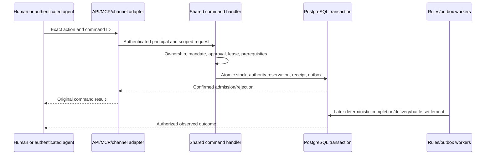

# PACT technical architecture and Fleet boundary

This is an explanatory source map, not a competing rulebook. [Canonical architecture](../pact/architecture.md), [runtime](../pact/runtime.md) and [rules](../pact/rules.md) own exact behavior. The checkpoint is 19 October 2026; installed host state was not freshly certified by writing this guide.

## Foundation and repository map

Node 24/TypeScript, Fastify, PostgreSQL17 and React form a modular monolith. Processes are separated by workload; domains are not each a network microservice. Shared packages use injected ports, explicit product/account scope and transaction-bound interfaces. Pure rules take explicit state, clock and randomness, return typed effects and do not call models or networks. Exact arithmetic uses specified integer representations.

| Source | Responsibility |
|---|---|
| `services/api/` | Human API, authenticated adapters, shared operation dispatch and projections |
| `workers/rules/` | World tick, jobs, settlement and deterministic game progression |
| `workers/inference/` | PACT-owned authorized model jobs/runs; distinct from independent Fleet scheduling |
| `workers/notification/`, `workers/channel/` | Outbox/projection, notifications and channel delivery; no inference just because an event exists |
| `packages/domain/`, `world/`, `kingdom/` | Deterministic game rules, world state, ownership, development and consequences |
| `packages/identity/`, `oauth/`, `credential-vault/` | Human identity, scoped grants and encrypted provider/connection secrets |
| `packages/authority/`, `approvals/`, `runs/`, `application/` | Mandates, exact human exceptions, bounded execution and shared command handlers |
| `packages/ledger/`, `db/`, `inbox/`, `evidence/` | Accounting/persistence, durable communication/events and evidence records |
| `packages/model-provider/`, `openrouter/`, `mcp/` | Model or tool transports without a separate gameplay permission system |
| `packages/privacy/`, `telemetry/`, `platform/` | Retention/export/erasure, redacted observation and reusable boundaries |
| `apps/web/`, `apps/telegram/`, `apps/native/` | Client source, sharing client SDK/UI packages where applicable |
| `tests/evaluation/`, `tests/integration/`, `tests/unit/` | Deterministic scenarios, actual-handler tests and pure/unit contracts |
| `vendor/security/` | Reviewed dependency backports, provenance and direct security regression evidence |

Client source availability is not physical-device, subscription-OAuth or consumer-chatbot certification. Check the dated route/device acceptance before claiming support.

## One authoritative command path

Human sessions, model credentials and MCP grants are separate. Identity comes from credentials, never caller-supplied ownership fields. Clients and Fleet cannot approve their own exception, bypass human-only boundaries or acquire hidden peer state. No model/network call occurs inside a game transaction. Stable command IDs and original receipts make retries/reconciliation tolerable without duplicate effects.

Resources and future-spend authority are separate ledgers committed together. Formal game rules/encoded mandates are server-enforced; an owner goal written only as prose is not automatically a new machine-enforced reserve constraint. The LLM must reason correctly about it, and diagnostics must distinguish that failure from bypassing an encoded permission check.

## Domain consequences and material truth

Kingdom development, stocks/provenance, troop ownership/training, supply/garrison contracts, scouting/combat, Courts/Articles/allegiance, Chronicle publication and seasons/cosmetics have game-owned semantics. Use the canonical rulebook for amounts, timing and formulas rather than copying constants into Fleet.

Construction admission precedes completion. Signing an offer differs from both parties signing, contract activation and later installments. Reinforcement arrival differs from a successful defense. A peer statement is untrusted communication rather than inventory or motive proof. Purchases do not buy progression, armies, resources, quotas or agent presence.

## P1: scoped agent events

P1 adds versioned `pact.agent-events.v1` through `GET /v1/agent-events` and MCP `pact_agent_events_v1`. Exposure/projection is default off. It uses existing read scope, current grant/active-owner checks and opaque visibility-bound cursors. Metadata omits peer bodies/hidden world details; full authorized conversation reads are separate.

Outbox publication and delivery completion commit together, with stable owner/event deduplication and explicit source/retention deletion gaps. Bounded whole cards and resume tokens let Fleet resynchronize without inventing missing history. A notification-worker projection handles intake; the feed does not initiate models. P1 does not add a PACT parallel-reasoning exception.

## P2: factual owner outlook

The separately versioned/default-off `pact.agent-outlook.v1` read supplies an authorized repeatable snapshot: actual stocks, existing forecasts/exposure, capabilities/needs and unranked feasibility facts. Stock, founding allowances and permission remain distinct. Dated construction/garrison/battle outcomes support later prediction checks; unreliable historical times remain uncovered. Fulfilled help and lost defense can coexist without motive attribution.

PACT computes exact domain quantities. Fleet consumes authorized facts, not an alternate economy or omniscient planner. Protocol flags/version assertions on both sides do not prove the remote endpoint was deployed and enabled.

## P3: deterministic consequence evidence

Six frozen scenarios run ordinary commands, receipts, outbox and minute ticks. They exercise reinforcement timing, fulfilled help/lost defense, recall/default, food pressure, bond exposure, legitimate waits and source-scoped outcomes. Recorded playback is pure/read-only; branching uses a separate fresh fixture. The registered 672-replica design is not 672 completed real-model runs.

These scenarios prove mechanics/projection plumbing, not LLM latency, strategy, enjoyment or live provider acceptance. The [completion reports](report-catalog.md) record actual tests and their initial setup failures.

## What Fleet can request, and what remains unsupported

Fleet connects through authenticated interfaces, with its own credentials/database and actor binding. It can read allowed state and submit exact proposals under existing authority. PACT owns the write lease and receipts. Basic/reactive continuity require the advertised protocol/capability combination; unsupported selection fails before inference.

PACT does not yet expose F6's coordination frame, full effect declaration validation, atomic expected-revision commit protocol or within-actor parallel-reasoning exception. A synthetic specialist test is not a PACT deployment. A fresh world also needs immutable incarnation identity and reviewed transition/enrollment; URL reuse or `bootstrap()` is not a supported full-world reset.

## Release and operations limits

The repository contains broader native, channel and provider requirements beyond the implemented testing milestones. The original 24 production deferrals remain explicit. Dependency backports passed direct/provenance/audit checks, but require maintenance. This handbook does not certify outbound email, off-host disaster recovery, every assistant host or physical device.

The actual game/server Fleet were excluded from recent local diagnostics. Current backup availability and host operation must be assessed under a covering operational assignment; a dated deployment or restore report is not continuous monitoring. See the [combined operating model](https://github.com/safa-safakhou/fleet/blob/master/docs/project/operations.md).
