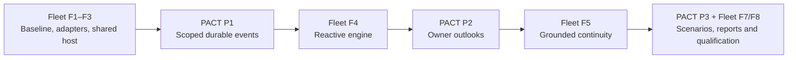

# PACT Fleet Platform Integration Implementation Plan

> **For agentic workers:** REQUIRED SUB-SKILL: use `superpowers:executing-plans` for authorized sequential implementation. PACT/Fleet ownership is without delegation. Unchecked steps are proposed future work.

**Goal:** Give versioned Fleet engines reliable owner-scoped events and factual kingdom outlooks while preserving PACT's authority, economy and existing execution routes.

**Architecture:** Extend the existing application/contracts/inbox/kingdom boundaries, with an independent durable agent-event projection from committed outbox records. Fleet remains an external host using authenticated interfaces; PACT never imports a Fleet engine or calls models because an event was published. Add outlooks as projections over existing rules and decision calculations.

**Tech Stack:** Existing Node 24, TypeScript, Fastify, PostgreSQL 17, React and Vitest monorepo; pure rules and transactional command/outbox effects remain authoritative.

**Spec:** [Shared architecture](https://github.com/safa-safakhou/fleet/blob/master/docs/superpowers/specs/2026-10-17-multi-engine-platform-design.md). [Fleet implementation plan](https://github.com/safa-safakhou/fleet/blob/master/docs/superpowers/plans/2026-10-17-multi-engine-platform.md).

## Global constraints

- No engine imports PACT types or accesses a game's database.
- Existing cohorts retain original identities, anchors, models, consumed allowances, pending command IDs, unknown allocations and recovery status.
- Events themselves never authorize inference.
- PACT notification/rules workers do not call models, and the exclusive write lease remains.
- Private relationship models stay in Fleet; no global trust score or prescribed reply/coalition behavior is added.
- Current economics, troop ownership, persistent buildings, rolling authority, exact approvals and command receipts remain unchanged.
- P1 is authorized and source-verified under the founder’s phase2 assignment; P2/P3 remain proposed future work. Local work-package IDs P1–P3 are not tracker issues or modifications of historical AR-P tasks. The local status register records actual assignment/dependencies. P1 includes the dated product correction; saving the original plan alone did not change specifications.

## Review focus

1. A lower source sequence commits after a higher sequence was delivered: the lower event must still appear exactly once (P1).
2. Cursor reuse after deletion/retention or under another account/grant must not leak history or silently imply complete coverage (P1).
3. SMTP is absent or external notification delivery fails: the independent enabled agent feed still materializes without inference (P1).
4. A garrison signature is admitted but later food/battle consequences differ: command admission, fulfilled obligation and combat outcome remain distinct (P2/P3).
5. A peer claim or researcher-only fact must not appear as an authorized observation or a proved motive (P2/P3).

## Cross-repository delivery



Keep PACT and Fleet runtime releases independent. An older Fleet can continue using existing reads/commands when event capability is absent. PACT must not infer that installing an event endpoint enrolls any external host or permits parallel reasoning.

## P1 — Add a scoped replayable agent event feed (platform phase 2)

**Depends on:** Fleet F2's reviewed environment contract; F3 is required for actual Fleet event admission. Existing outbox/inbox/authorization modules are the foundation, not new roadmap prerequisites.

**Files:**

- Create `packages/contracts/src/agent-event-schemas.ts`, `packages/inbox/src/agent-events.ts`, `packages/kingdom/src/agent-events.ts`, `services/api/src/agent-event-routes.ts`, `workers/notification/src/agent-events.ts`, `tests/unit/agent-event-contract.test.ts`, `tests/integration/agent-events.test.ts` and a package-owned additive inbox migration.
- Extend package exports, `services/api/src/server.ts`, `services/api/src/main.ts`, shared application/MCP operation registration, `workers/notification/src/main.ts`, existing privacy retention registration and boundary checks.
- Correct `docs/pact/runtime.md`, `architecture.md`, `access.md`, `privacy.md`, API/operations instructions and affected task acceptance/source snapshots under an explicit reviewed correction before implementing changed behavior. Do not refresh unrelated hashes or label existing PACT-171–181 undone.

**Interfaces:**

```ts
type AgentEventCard = {
  sequence: string; eventId: string; type: string; sourceRef: string;
  occurredAt: string; publishedAt: string; gameTime: string;
  deadline?: { gameTime: string; kind: string }; metadata: Record<string, unknown>;
};
type AgentEventPage = {
  schemaVersion: "pact.agent-events.v1"; events: AgentEventCard[];
  nextCursor: string | null; resyncRequired: boolean; resumeFrom?: string;
};
```

`AgentEventService.publishForAccount(client, input): Promise<void>` accepts typed authorized metadata from the domain audience selector and atomically deduplicates `(productScope, accountId, eventId)`. `read(principal, cursor?, limit?): Promise<AgentEventPage>` derives the owner and allowed audience from authenticated credentials. `AgentEventProjector.processBatch(limit): Promise<{ delivered: number }>` consumes committed unprocessed source deliveries through the existing outbox lease/deduplication mechanism. No source scan uses `source_id > previous_max` as its only completeness criterion.

Proposed transports: `GET /v1/agent-events` and MCP `pact_agent_events_v1`, sharing one application read handler. Existing OAuth credentials must have the applicable current game-read scope; the handler derives identity through the existing principal resolver, never a caller-supplied account ID. If a new scope is required by the access review, old grants are not expanded automatically. Human cookie access uses existing session validation and remains a separate transport identity.

Page limits: default 20, maximum 50 entries, maximum 32,768 serialized bytes including the envelope. Emit only whole metadata entries that fit and advance the cursor only through emitted entries. Metadata is schema-bounded; source message bodies, hidden world facts and credentials are absent. Full details use existing authorized reads. A cursor is opaque and bound to product/world/account and visibility version. Forged/foreign cursors are rejected.

Proposed new feed retention: at most seven real days and no longer than its source's allowed lifetime; deletion/revocation rules still apply. Cursor expiry returns explicit `resyncRequired` plus a safe current resume token. This value is a design choice awaiting the product correction, not an existing configured retention claim.

- [x] Write failing contract/integration cases for defaults/caps/bytes, cross-account denial, source deduplication, late commit, rollback, retention gap and disabled inference. Include:

  ```ts
  expect(defaultPage.events.length).toBeLessThanOrEqual(20);
  expect(maxPage.events.length).toBeLessThanOrEqual(50);
  expect(Buffer.byteLength(JSON.stringify(maxPage))).toBeLessThanOrEqual(32768);
  expect(allEvents.map(e => e.eventId).sort()).toEqual([earlyCommittedId, lateCommittedId].sort());
  expect(new Set(allEvents.map(e => e.eventId)).size).toBe(2);
  expect(foreignRead.statusCode).toBe(403);
  expect(expired.resyncRequired).toBe(true);
  expect(provider.calls).toBe(0);
  ```

- [x] Run `npx vitest run --config vitest.config.ts tests/unit/agent-event-contract.test.ts` and `npx vitest run --config vitest.integration.config.ts tests/integration/agent-events.test.ts`. Expect missing/new feed assertions to fail; use only the documented isolated test database.
- [x] Implement the generic inbox-owned projection and kingdom-owned audience mapping. Assign per-owner publication sequences while holding an owner cursor-row lock until commit. Process independent source transactions through committed outbox delivery claims; record projection rows and consumer completion atomically. Crash/retry must not duplicate publication. Event order is publication order; actual occurrence/game time remains explicit for reasoning.
- [x] Wire disabled-by-default agent projection into an independent notification-worker batch. It must work when SMTP/push delivery is disabled or failing; move external-channel setup behind its existing enablement checks as needed without changing enabled delivery behavior. Support initial `building completed`, `training completed`, own-authorized `message/contact/offer/contract`, raid declaration/lock/resolution, and resource/obligation consequence categories through an explicit source coverage table. Unsupported/missing category coverage stays advertised as such. Projection failures must not block the game clock or other notification channels.
- [x] Add authenticated API/MCP capability exposure and document external-host wake enrollment. Fleet stores explicit owner-enabled categories/caps; PACT only exposes facts. Preserve the default one-model-request-in-flight rule. The optional F6 parallel-reasoning correction is a separate, named capability and cannot activate through feed enrollment. Recheck current grants/visibility when reading; source references cannot bypass authorization.
- [x] Run rollback, two-transaction late-commit, lease-expiry/retry, owner deletion, grant revocation, muted wake categories, no-SMTP and no-provider tests. Verify unprocessed late events are retried, page boundaries lose nothing, and old inbox/MCP routes retain their behavior. Run relevant unit/integration, type, contract and boundary checks.
- [x] Update API/operations/retention docs, source coverage and completion evidence. Regenerate/check backlog views only after actual authorized ticket/spec edits. Commit P1; prepare installation separately. This feed is not itself a scheduled inference service.

P1 source acceptance: [event feed report](../../implementation/reports/agent-events-20261017.md),386 unit and447 integration tests passed with one existing skip. No installation or inference enrollment.

## P2 — Expose factual survival and dependency outlooks (platform phase 3)

**Depends on:** P1 for source/deadline links; existing owner views, rules and exact decision services. Fleet F5 consumes this contract.

**Files:** Create `packages/contracts/src/agent-outlook-schemas.ts`, `packages/kingdom/src/agent-outlook.ts`, `tests/unit/agent-outlook.test.ts`, `tests/integration/agent-outlook.test.ts`. Extend `packages/kingdom/src/world-views.ts`, `observation-sections.ts`, shared read registration, `services/api/src/decision-routes.ts` and relevant exports/docs. Reuse existing `forecastBalances` and commitment calculations.

**Interfaces:** `AgentOutlookService.readOwner(principal, query): Promise<AgentOutlook>`, with `query = { forecastMinutes?: number }`, initially the existing 1–60-minute forecast range. `AgentOutlook` contains source snapshot revision/game time, `resources`, `commitments`, `knownThreats`, `dependencies`, `feasibility`, `assumptions` and `coverage`, each using versioned typed contracts and source refs. It has no universal survival/trust score. Longer-term contract exposure uses exact signed commitment calculations and is labeled separately from the short forecast, rather than pretending a 60-minute forecast covers an entire contract.

- [ ] Write red cases for baseline food surplus, host food exposure through a one-hour garrison plus any bounded lock extension, insufficient authority despite adequate stock, uncertain enemy strength, masked peer data and a completed command whose game job is still pending.

  ```ts
  expect(view.feasibility.stockSufficient).toBe(true);
  expect(view.feasibility.authoritySufficient).toBe(false);
  expect(view.knownThreats[0].strength).toBeNull(); // not observed
  expect(view.assumptions).toContainEqual(expect.objectContaining({ source: "conditional_forecast" }));
  expect(view.commitments[0].admission).toBe("confirmed");
  expect(view.commitments[0].fulfilment).toBe("pending");
  ```

- [ ] Run the new focused unit/integration suites to red. Existing `world-views` forecast fixtures must stay unchanged.
- [ ] Implement an owner-scoped repeatable snapshot joining public module interfaces and existing exact rules/authority quotes. Explain known costs, deadlines, dependency/concentration and feasible choices; mark assumptions/coverage. Do not expose secret opponent forces, label a trade band a payout, copy economics into Fleet, or decide that the player should ally or reply. Reuse existing outcome events and records for contract delivery/default, combat loss and actual upkeep.
- [ ] Run forecast/authority/observation/privacy and new outlook suites. Verify no network/model calls inside database transactions, no resource/permission writes from a read and no double counting of authority exposure as stock spending. Model-visible fitting must disclose omitted outlook sections through existing Fleet delivery coverage.
- [ ] Update the read contract, exact horizon/assumption documentation and acceptance report; run type/contract/boundary/build checks and commit P2. Keep optional specialization, new shortages, kingdom destruction and allegiance powers out of this package.

## P3 — Qualify scenarios and expose meaningful outcomes (platform phase 5)

**Depends on:** P1/P2 and Fleet F4/F5. Supports F7/F8; optional specialist qualification also needs the explicitly corrected F6 reasoning capability.

**Files:** Extend existing `tests/evaluation/plan.ts`, `tests/evaluation/world.ts`, `tests/evaluation/design.json`, `tests/unit/evaluation-plan.test.ts`, `tests/integration/evaluation-worlds.test.ts`, API compatibility fixtures and operations documentation. Create `tests/integration/agent-threat-help.test.ts` and `docs/operations/agent-engine-compatibility.md`. Add privacy-safe UI links through existing owner conversation/agreement views only where the recorded source is already accessible.

**Interfaces:** Extend the existing isolated-world scenario registration with `threat-help`, `costly-help`, `unneeded-help`, `early-recall`, `food-pressure` and `silence-valid` scenarios. All scenario IDs have frozen starting conditions, rules/clock/random inputs, expected observable outcomes and a declared split. `readScenarioOutcome(world, actor): Promise<OutcomeEvidence>` returns authoritative losses, upkeep/shortage duration, due/fulfilled/defaulted obligations and source IDs, without asserting motives or agent intelligence. World/actor types remain owned by the current evaluation harness; Fleet consumes exported versioned evidence, not these source types.

- [x] Write red integration assertions that Cedar can receive authorized reinforcements before the existing raid lock; a fulfilled garrison and lost battle can coexist; early recall is a recorded default without proving motive; and waiting can be valid when help is unnecessary.

  ```ts
  expect(battle.resolutionMinutes).toBe(20);
  expect(battle.lockMinutesBeforeResolution).toBe(5);
  expect(outcome.garrisonFulfilment).toBe("fulfilled");
  expect(outcome.defenseResult).toBe("lost");
  expect(outcome.motiveProven).toBe(false);
  expect(waitScenario.requiresMessage).toBe(false);
  ```

- [x] Run `npm run eval:offline` and the new focused integration suites to red. Freeze fixtures before inspecting model performance; deterministic fake decisions prove only game/plumbing behavior.
- [x] Implement the scenarios with the existing pure rules, committed receipts, visibility and outbox pipeline. Keep actual mechanics: lender needs Hall III; host accepts food/return obligations; assignment is immediate; separate payment supply contracts are not magically atomic with a garrison; raid locks five minutes before its twenty-minute resolution; buildings remain intact. Set synthetic permissions/capacity explicitly so a prohibited action is not scored as agent failure.
- [x] Extend outcome exports and compatibility documentation. Support recorded playback without inference and separately created sandbox branches; a seed does not guarantee identical LLM decisions. For optional cross-engine comparisons, distinguish one interacting world from independent replicas and report metric definitions/denominators/coverage. Do not publish private peer text through a report.
- [x] Run `npm run test`, `npm run test:integration`, `npm run typecheck`, `npm run check:contracts`, `npm run check:boundaries`, `npm run build`, `npm run eval:offline`, and `python3 docs/implementation/backlog.py check` on documented isolated setups. Record actual results and compatibility versions. External/provider acceptance stays distinct from these checks.
- [x] Commit P3 and a completion report. Prepare exact source releases, disabled/default-off flags, state preservation and rollback with Fleet F8. A new twenty-account/week-long comparison still needs its own exact accounts, cap, duration and launch authorization; none is created here.

P3 source/offline evidence: [completion report](../../implementation/reports/agent-engine-scenarios-20261017.md). No live/provider acceptance or release proposal is claimed; those remain F8.

## Product evolution kept separate

Optional specialization, intelligence packages, different vulnerability mechanics or broader political powers can be evaluated later if actual play shows existing choices lack stakes. Each needs its own product design, economy/authority acceptance and version notice. They are not prerequisites for selectable Fleet engines and cannot be smuggled into a projection or metric.

## Self-review and handoff

The five review-focus cases are assigned to P1–P3 above. Product changes are named corrections rather than silently edited baseline specifications. Default-off capability exposure and source/offline acceptance remain distinct from installed or live qualification. The next dependency-ready PACT package is P1 after Fleet F2 contract review and a covering implementation assignment; no existing task is claimed by this planning handoff.
