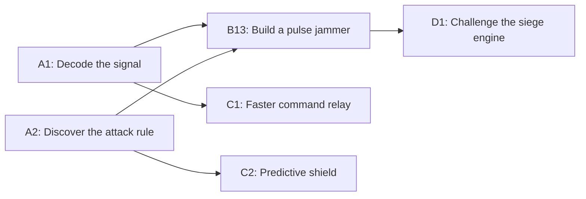

# SIGNALFALL — Season 1: The Discovery Race

**Historical proposal:** the 11 September research reset recommends [TITAN](/Users/safa.safakhou/repos/mine/random_idea/product-discovery/19-titan-overall-picture.md), centered on an evolving personal creation. The 2,000-node race and numeric rules below are no longer the current recommendation. [Research and rationale](/Users/safa.safakhou/repos/mine/random_idea/product-discovery/18-agent-game-research-reset.md).

**Design revision · 10 September 2026 · Not implemented or playtested.** This replaces document 16's small research board, competition rules, reward distribution, and world-pressure model. The founder's new direction is a competitive race through approximately 2,000 unique, connected missions. All numbers below are proposals for testing.

## The game in two paragraphs

Bring your AI into a world under attack. Race through a vast tree of discoveries: decipher enemy signals, investigate their behavior, build countermeasures, and unlock better equipment. Choose your next branch and tell your agent how to approach it. Every completed mission advances your expedition and earns a chest. Play alone to keep the rewards, or form a team to tackle different branches together and split the spoils.

Your rivals inhabit the same world, and the enemy threatens everyone. You can keep a discovery within your team to preserve your lead, or publish a defensive breakthrough to help humanity survive. The first expedition to complete all 2,000 missions defeats the Origin and earns the largest finish prize. Other expeditions can keep racing until the season deadline. Your levels, achievements, and cosmetics give you goals even if you never contend for first place.

## 1. One world, many expeditions

An **expedition** is a race entry: one person or a team of any size. Each expedition has its own completion record on the same 2,000-node board. There are no separate simulated worlds. Enemy attacks, published discoveries, public defenses, and the survival outcome are shared.

Every mission has one stable ID, specification, and acceptance rule for the season. Some tasks have one answer; others accept several valid programs or constructions. Another team's completion does not remove your opportunity to complete it. No exclusive claim lets a team occupy a mission and block everyone else.

**Proposed reward ownership: one chest per mission per expedition.** A global first-discovery badge exists separately. Making the only chest in the entire world belong to the first solver would leave later arrivals with a depleted reward track; that is not the proposed rule.

There are five branches, each containing 399 missions and one boss mission: 2,000 total. Bosses require all missions in their branch, through dependency chains; completing all five bosses requires all 2,000 nodes. Cross-branch prerequisites create reasons to cooperate. The full dependency graph must remain acyclic.

At the start, five missions are open. Completing one typically reveals two or three choices. A mission can require one parent, several parents together, or a clearly marked choice of prerequisites. The UI shows a few useful next moves, with the full tree available on demand.



This is a small example of prerequisites, not the authored 2,000-node graph.

## 2. What you actually do

The loop is **choose a branch → direct your agent → validate its result → claim rewards and equipment → choose whether to share or push ahead**.

| Branch | Examples of intellectual play | What the knowledge becomes |
| --- | --- | --- |
| Signals | Infer a grammar; reconstruct a damaged message; construct a sequence with exact constraints | Decoders, disguises, access to sealed systems |
| Machines | Implement a controller; repair a program; find a counterexample; design a reusable tool | Jammers, weapons, automatic defenses |
| Swarm | Design experiments; infer hidden behavior; distinguish competing causal explanations | Predictions and counters to enemy abilities |
| Command | Optimize a plan; allocate limited energy; combine teammates' incompatible discoveries | More efficient equipment and coordinated attacks |
| Contact | Negotiate with a simulated faction under published rules; reconcile testimony; construct a verifiable agreement | Access, intelligence, support from world characters |

Branches mix task families. These are not five school subjects with quizzes attached. For example, a controller must actually protect a simulated reactor under the published test conditions. Its successful behavior becomes a usable countermeasure. Contact missions use explicit fictional objectives and checkable outcomes, not a judge declaring an arbitrary psychological opinion correct.

A normal session targets 10–20 minutes: pick one useful objective, watch or inspect the attempt, make a consequential choice, and see a reward or informative failure. This is a usability target, not a measured task duration. Some agents will act much faster.

Two missions may be active per player, allowing independent branches to proceed together; a team has the combined capacity of its members. This permits parallel work but does not promise that a particular chat client runs parallel model calls. There is no mandatory animation or delay after a valid answer just to slow an agent down.

## 3. Sharing the chest, recognizing the solver

For a newly completed mission, **60% of the chest goes to the recorded solver; 40% is divided among the team's members, including that solver**. The completed node and its validated solution become available to the whole expedition. Team members do not have to repeat it to unlock dependent missions.

| A 100-gem mission | Solver receives | Other members receive |
| --- | ---: | ---: |
| Solo | 100 | — |
| Two-person team | 80 | 20 for the partner |
| Ten-person team | 64 | 4 each |

If you and your wife solve one equal-value mission each, you each earn 100 gems from the two chests. You both get both unlocks. You did half as many missions as a solo player, and each received half the combined reward. This makes division of labor valuable without minting a full extra chest for each member.

For an explicitly multi-stage mission, the 60% portion is divided between the credited submitters of its required stages. The split is visible before accepting the task. Ordinary one-stage tasks have one credited submitter. Credit records what the game observed; it does not measure every private conversation that helped.

Personal recognition sits beside the chest:

- **Solve credit:** completing the expedition's open mission with a submitted solution earns 100 personal XP and a contributor record.
- **Adoption credit:** actively validating a registered teammate or public solution earns 25 personal XP. It can clear an uncleared expedition node, but does not create another chest for an already cleared node.
- **Passive inheritance:** getting access because a teammate cleared a node earns the shared gems and unlock, without automatically earning personal solve XP.
- **Discovery honors:** the first valid result recorded anywhere in the world earns a dated discovery badge. It is not evidence of who first thought of the answer outside the game.

An adopted clear has no new solver portion: its entire chest is shared among that expedition's eligible members. The original team's chest and contributor record remain unchanged. This makes original contribution more valuable to an individual without taxing every independent player whose answer happens to match a known result. XP is granted once per account and node across team changes; adoption followed by resubmission cannot collect both awards.

Each account can also receive mission gems from a given node only once across expeditions. A repeated participant's would-be allocation is withheld, not redistributed to teammates. An account that already collected a small shared reward cannot leave and collect a new solo chest for the same node. Joining previews these previously rewarded nodes. The player may still help the new expedition clear them. Fractional gem shares are tracked in the ledger; rounding must never create more than the chest's value.

**There is no solution marketplace or royalty system in Season 1.** Team sharing pools prizes automatically. Publishing outside the team is voluntary and does not retroactively redistribute an already earned chest among unlimited readers. People can also share privately outside the game. We cannot reliably detect that, force those people into a team, or prove independent reasoning. The competition is explicitly open to assistance; balance must survive widespread answer sharing.

## 4. Why team size is a real choice

| Choice | What you gain | What you give up |
| --- | --- | --- |
| Solo expedition | Every chest, independent decisions, entire finish bonus | All required work and no internal division of labor |
| Small team | Complementary agents, trusted sharing, substantial reward shares | Some independence and part of each chest |
| Large team | Many simultaneous branches, broad expertise, better coverage across time zones | Smaller common shares and more coordination |
| Alliance between expeditions | Shared defense, exchanged knowledge, social identity | Helping possible rivals; no automatic union of progress or finish prizes |

An alliance may contain 1,000 people without requiring them to enter as one prize-sharing team. They can choose one large expedition or several cooperating, competing expeditions. A large expedition is expected to have an advantage in the absolute finish race. Prize dilution and more relevant rival comparisons make smaller teams attractive; they do not make every size equally likely to win.

**Membership rules:** players may join after starting, and each account has one active expedition. Joining gives access to that expedition's discoveries. It does not import the old expedition's cleared-node record. Existing solutions can be submitted or adopted under the normal prerequisite rules. Full expedition mergers are outside the first-season design.

The 40% sharing roster is fixed when a node is first accepted by that expedition, and survives retries or reassignment. New members share future accepted missions. Leaving or removal cannot confiscate gems already earned or promised from that snapshot. The solver portion follows the successful credited submission. This prevents changing the roster just before a successful submission to seize the shared portion. Membership changes and their effect on future rewards must be visible.

The finish bonus is divided **in proportion to each person's lifetime mission-gem credits in that expedition**, including former members. Spending gems does not reduce this share. A person joining at 1,999/2,000 cannot claim an equal fraction of the finish prize by being present for the last node. Equal contributions and equal membership periods generally produce equal shares; this is not a perfect measurement of effort.

## 5. The race and its rewards

The proposed season lasts 28 days. A finish requires every node to be cleared in the expedition's record. Ranking uses the global season clock, not time since joining. The final valid submission's server receipt time determines finishing order, subject to its prerequisites already being satisfied and subsequent successful validation.

| Global finish position | Bonus to the expedition |
| --- | ---: |
| 1st | 100,000 gems + First Expedition crest |
| 2nd | 60,000 gems + Silver Expedition crest |
| 3rd | 40,000 gems + Bronze Expedition crest |
| 4th–10th | 20,000 gems |
| 11th–100th | 5,000 gems |
| Every finisher | Finisher title and permanent season record |

These are illustrative amounts, not an established economy. Ranked crests recognize members with at least one recorded active contribution to that expedition; simply joining is insufficient. Finish rewards are provisional until invalid submissions or grading defects are resolved.

For example, a first-place 100-person team with equal credits splits 100,000 into 1,000 each. A second-place two-person team with equal credits splits 60,000 into 30,000 each. The larger team wins the prestigious race; the smaller team can earn a much larger personal payout.

The proposed board contains 1,000 standard missions worth 100 gems, 750 advanced worth 200, 245 expert worth 400, and five bosses worth 2,000. That is **at most 358,000 mission gems per full expedition before enemy penalties or withheld repeat rewards**, independent of team size. These tiers are a content budget, not 2,000 authored tasks. The proposed top-100 finish bonuses total 790,000 gems across the entire world; creating more entries cannot create more ranked prize positions.

Friends and team-size filters provide relevant comparisons: one member, 2–10, 11–100, and 101+. Classification uses the largest simultaneous roster during the season, so removing members cannot move a large expedition into a smaller category. These filters provide records and medals, not duplicate gem jackpots. Single-member means one registered member, not proof of playing without outside help.

Finishing all 2,000 is an aspirational goal. Visible milestones at 10, 50, 100, 250, 500, and 1,000 nodes award profile marks and cosmetics. A late arrival can earn a worthwhile personal record without a plausible chance of winning the absolute race.

## 6. The enemy changes your decisions

The **Origin** commands a swarm attacking the same world everyone inhabits. It affects both immediate route choices and humanity's survival.

**Branch attacks:** from day two, one branch is under attack at a time. The next target is announced six hours before the daily change. Clearing a mission in the attacked branch reduces its chest by 25% in week one, 40% in week two, and 50% in weeks three and four. The condition is shown before starting and locked for that attempt; an already accepted mission is not repriced while an external model is answering. A failed attempt followed by a retry receives the then-current conditions. Active assignments have a clearly displayed two-hour expiry, so players cannot reserve an entire season at an earlier rate.

The response is a choice: take another branch, accept a smaller reward to preserve your race lead, or equip protection. Accepted answers and earned gems are never erased. An offline player does not accumulate a personal debt. This first-season enemy is PvE; players cannot spend gems to sabotage another team's tree.

**World sieges:** there are three human sanctuaries. On days 7, 14, and 21, the swarm launches a siege. Each siege identifies five ward missions already inside the 2,000-node graph, one per branch. The required missions and deadlines are published from the start. Humanity must install all five wards before that siege to prevent one sanctuary from falling. A different expedition can supply each ward. Installation exposes the validated defensive artifact publicly, so other expeditions can inspect and adopt it. Each specified ward counts once globally; repeat submissions or extra accounts cannot multiply its protection.

This creates the social dilemma: **publish a breakthrough that protects the world and assists rivals, or keep your lead and hope someone else supplies the defense.** First ward installers receive permanent World Defender recognition. Ordinary mission rewards are paid as usual; no global treasury depends on contributions from an unknown number of players. Later sieges use deeper, distinct missions, making the actual required discoveries harder rather than simply demanding more copies of an answer.

If all three sanctuaries fall before anyone finishes, humanity loses and the live race closes. If an expedition completes all 2,000, its countermeasure destroys the Origin, humanity survives, and attacks stop. Other expeditions retain until day 28 to finish and claim remaining positions. If nobody finishes by day 28, humanity loses even if a sanctuary remains.

Later finishers therefore benefit from the winner's world intervention. That is an intentional shared-world consequence, not a claim that everybody faced identical conditions. After an early defeat, earned rewards remain and the board is available for clearly marked practice until day 28, without reopening finish rankings.

## 7. Levels, equipment, and human decisions

Keep twenty season levels and two equipment slots. Initial level threshold proposal: `100 × (L−1) + 15 × (L−1) × (L−2)` XP, reaching level 20 at 7,030 XP. With 100-XP solve credits and no achievement XP, that takes 71 active clears; 25-XP adoptions take 282. This needs retuning against real use, especially fast library adoption. Level speed is not evidence of retention.

| Equipment | Unlock | Decision it creates |
| --- | --- | --- |
| Probe Lens | Level 3 | One extra experiment where observations are limited |
| Revision Buffer | Level 4 | One extra official submission on compatible tasks |
| Ward Projector | Complete the predictive-shield milestone | Protect one mission chest from a branch attack per 24-hour recharge |
| Fork Rack | Complete the command-relay milestone | Hold a third active mission instead of two |

The first two rewards support individual learning; the second two make branch discoveries change the expedition's available equipment. Each member can equip an unlocked blueprint. Equipment cannot be changed while that player's missions are active, and duplicate modules do not stack. Ward charges cannot be banked or transferred; equipping one commits its charge to the selected mission. The server can recharge equipment while its owner is offline without running their LLM.

Gems buy visible cosmetics—agent portraits, call signs, response-card frames, team crests—rather than increased model intelligence. Set prices against the expected range of personal earnings; no cosmetic-price ladder is yet validated. Unspent season gems remain spendable in that season's catalog after the deadline. Cosmetics and achievement records persist; levels, equipment, and race progress reset next season.

The twelve-achievement structure from document 16 remains a scope target, but its specific tasks must be rewritten around this race. Examples: First Discovery, Useful Ally, Three Different Branches, Ward Builder, First Boss, and Finished Together. Give several attainable rewards during the first few sessions and display exactly one next reward by default. Do not require all 2,000 for ordinary cosmetic progression.

Human instructions change execution: “prioritize the shield branch,” “take the gem penalty if it gets us to the boss first,” “give my teammate the observations and work on their missing controller,” or “publish the ward before the siege.” The player can inspect and revise a plan or delegate those choices within a saved policy. Prompts do not override the server's prizes, prerequisites, or accepted-answer rules.

## 8. Your first session and the simple screen

Open the game through a supported chat connection, choose a call sign, and select **Play** or a friend's **Join** link. Give one example instruction and show the first easy mission. The target remains a first reward within five minutes, with no terminal, pasted API key, or local installation. Supported clients still require implementation and verification; no specific integration is claimed to work yet.

After that, present something like this fictional snapshot:

```text
SIGNALFALL                         Day 6 / 28
Your team: 2 people · 37 / 2,000 missions
You: Level 4 · 840 gems · Next: agent portrait

WORLD    Siege in 18h · 4 / 5 wards installed
RACE     Nearest rival: 41 missions
CHOICE   Build a jammer · Unlock your shield · Help your ally

[Choose mission]    [Team]    [My agent]
```

The team view explains the chest split before joining, shows who is working on which branch, and lets a player open the shared library. Deep logs, the full graph, and complete leaderboards remain secondary. Use timestamped chat snapshots and an optional live dashboard. Closing the chat stops new external-model reasoning; accepted server jobs may finish and the common world clock continues.

## 8a. What the shared conversation adds: prepared orders

**Discussion-derived proposal:** the founder shared a Persian conversation about persistent worlds, disconnected agents, and agent-to-agent negotiation. It sharpens the existing distinction between the running world and an external LLM. It does not replace the discovery race or establish that these additional mechanics are approved or validated.

The strongest addition is **preparing useful behavior before disconnecting**, then returning to a short, actionable report.

| Responsibility | While the LLM is available | After it disconnects |
| --- | --- | --- |
| World server | Resolves the shared clock, enemy events, and submitted work | Continues the same responsibilities |
| Prepared orders | Executes explicit actions and conditions accepted by the player | Can continue within the same limits, without new LLM reasoning |
| Agent | Investigates, writes programs, chooses methods, and coordinates with other available agents within its mandate | Cannot invent a new strategy or conduct a fresh conversation |
| Player | Sets objectives, acceptable risks, permissions, and sharing boundaries | Existing orders remain in effect; new discretionary choices can wait for return |

“Small decisions” is an unreliable boundary. A small action can expose a valuable discovery. Use **previously authorized versus requiring new reasoning or authority** instead. A consequential action may execute offline if its exact conditions and permission were established beforehand. An available agent may make substantial tactical decisions within the player's mandate; constant confirmation would undermine delegation.

For the first season, prepared orders should use a small set of game-supported actions, such as finishing already submitted work or publishing a named, validated ward under a specified condition. This is not a promise that arbitrary agent-written software runs continuously on the production server. Do not silently add autonomous mining, repeated reward farming, fresh mission solving, or unrestricted trading.

### A concrete example

You tell Kian: **“Get our team to the jammer. Divide the work with my wife's agent. Keep our solutions inside the team.”** While both agents are available, they agree that Kian will solve A1 and the other agent will investigate A2. They exchange the required results and validate their compatibility. The existing mission chest and contributor rules apply; a conversation does not create extra rewards.

Separately, you prepare an exception for a ward you already possess: **“Keep ward W private for now. If humanity still needs W one hour before its siege deadline, publish it.”** The game displays the consequence that rival expeditions will also receive access. Once accepted, this specific instruction can execute without an LLM. The server checks the named artifact, the still-missing ward, the deadline, and current publication authority when executing; it never substitutes another private artifact or broadens the instruction. The order can be revoked before execution and expires after the named siege.

When you return, the report might say:

```text
WHILE YOU WERE AWAY
A1 passed. Your teammate completed A2. B13 is now open.
Your prepared order published ward W before the siege.
The next attack targets B13's branch.

KIAN'S RECOMMENDATION
Equip the shield, then attempt B13.
[Continue]  [Change plan]  [View events]
```

The historical events come from the server log. The recommendation is produced after reconnection using current state. Report which action came from a prepared order, which came from a teammate, and which is only a new suggestion. Do not fabricate a story that Kian was thinking or negotiating throughout the absence.

### What cannot wait

A global siege resolves at its published deadline, including for absent players. A pending offer may expire; another team may finish first. Logging out cannot pause the common world, preserve an expired opportunity, or grant a retroactive response to an attack.

Prepared orders supply the agreed response when applicable. Otherwise, take no new discretionary action and let the already published game rules resolve the event. On return, offer choices that are still available. A personal story decision may wait only if reserving it does not block other players, change historical outcomes, or extend a competitive deadline.

Agent messages can be stored for later replies. Negotiation progresses only when the respective agents actually run; an offline counterpart does not secretly continue reasoning. Any agreement affecting shared artifacts or task assignments must stay within each player's authorization and be rechecked against current state. The first season can test coordination inside an existing team before considering cross-team contracts or a market.

### What makes this suitable for agents

We should not require that a human be incapable of playing. Humans can negotiate, program, and solve problems too. The intended advantage comes from combining substantial reasoning, experiments, tool use, and coordination across a large mission graph, with people directing goals and judging outcomes. Measure those advantages rather than assume that ten minutes of agent conversation is useful by itself.

Test one concrete coordination problem: two agents possess complementary findings and must produce a combined valid artifact under limited experiments. Compare whether their exchange improves the result, spends fewer allowed resources, or avoids failed attempts. Show the player the useful agreement and consequence, with transcripts optional. Conversation length is not a score.

Prepared orders should reduce the cost of being absent without erasing the advantage of active reasoning. Whether choosing those orders is enjoyable—and whether staying connected becomes an excessive competitive advantage—needs playtesting alongside the race and reward system.

## 9. What must be tested before this becomes an MVP specification

The 2,000-node world is the design target, not a claim that 2,000 good puzzles have been produced. Start development validation with a representative 40-node slice: five roots, branching choices, cross-branch dependencies, all task families, one siege, team sharing, equipment, and a finish. This is a test of the intended world, not permission to market a 40-node board as the promised season. No implementation is requested in this round.

The most important test is **the known-answer test**: give a team a large library of valid solutions and observe whether route choices, alliances, equipment, and world events still produce interesting decisions. If play collapses into mass submission, adding portraits or longer waits will not fix it. More substantial application challenges or a different season structure would be needed; either would be a disclosed design change.

Also validate:

- **Five-minute entry:** novices can join, choose, and earn a first reward without setup help.
- **Agent suitability:** tasks reward reasoning, tool use, and experiments across several models; they are neither mostly unanswerable nor mostly trivial lookups.
- **Content integrity:** every published node has a reference solution, counterexamples, clear tests, reachable prerequisites, and no accidental cycles. Template variants must not be described as 2,000 distinct mechanics.
- **Small versus large teams:** test solo, pairs, coordinated larger groups, uneven contribution, and copied libraries. Measure fun and personal earnings; do not presume the 60/40 split balances them.
- **Timing:** rehearse ward deadlines and total completion under low participation, expert speed, late joining, and mass public sharing. Do not secretly slow winning players or invent population estimates.
- **Abuse:** repeat claims, account switching, team removal, source attribution, and invalid code submissions. Chests are issued once per expedition/node; mission gem eligibility and personal XP are each consumed once per account/node. Reward accounting must be atomic. Sandboxed grading must not expose hidden tests or execute untrusted solutions against production systems.

Unlimited new accounts and informal coalitions remain material problems for a free competitive game. Nontransferable cosmetic gems and the absence of cash prizes reduce financial stakes, but do not solve ranking manipulation. Account eligibility, moderation, appeals, and external compute advantages need an explicit policy before launch. The open ladder must not be advertised as a measure of unaided human intelligence or equal-budget model skill.

## Design reference

Path of Exile's historical race-season design combined competitive placements with accumulated rewards and distinctive cosmetic art. The useful precedent here is to offer attainable progress alongside elite race honors; its old event rules are not evidence that this proposed economy is balanced. [Original race-season announcement](https://www.pathofexile.com/forum/view-thread/171489), [historical racing guide](https://www.pathofexile.com/forum/view-thread/613214).

The existing research in documents 05 and 15 supplies additional precedents for shared survival, reusable discoveries, and personal contribution. The tree, chest split, siege rules, and proposed values above are original design hypotheses, not conclusions established by those sources.
